# Panduan Pengguna QualiText (`USER-JOURNEY.md`)

Panduan ini menjelaskan langkah demi langkah cara menggunakan aplikasi **QualiText** dari awal hingga akhir—mulai dari **menyiapkan data mentah**, **memasukkan dataset**, **menilai kualitas**, **membersihkan data pribadi (PII) & duplikat**, sampai **mengambil hasil akhir (ekspor dataset siap latih LLM dan laporan HTML/PDF)** lengkap dengan **endpoint API** di setiap tahap.

---

## Gambaran Alur Kerja (Dari Data Masuk Sampai Hasil Akhir)

```mermaid
flowchart LR
    S1["1. Login & Cek Ringkasan"] --> S2["2. Buat Dataset & Input Data"]
    S2 --> S3["3. Pemetaan Kolom & Cek Error"]
    S3 --> S4["4. Jalankan Penilaian Kualitas (DQI)"]
    S4 --> S5["5. Periksa & Bersihkan PII / Teks di Explorer"]
    S5 --> S6["6. Hapus Duplikat Semantik"]
    S6 --> S7["7. Atur Kebijakan (Quality Gate)"]
    S7 --> S8["8. Nilai Ulang Versi Bersih"]
    S8 --> S9["9. Hasil Akhir: Ekspor Dataset & Unduh Laporan"]
    S9 --> S10["10. Audit Log, API/Webhook & Retensi UU PDP"]
```

> [!TIP]
> Setiap perubahan atau pembersihan data di QualiText **tidak merusak data asli**. Sistem selalu membuat **versi baru (`v2`, `v3`, dst.)** secara berurutan agar riwayat perubahan mudah dilacak dan dibandingkan.

---

## Persiapan Awal (Menjalankan Aplikasi & Akun Uji)

### 1. Menyalakan Aplikasi Secara Lokal

Jika menjalankan dari source code lokal (menggunakan [Makefile](Makefile)):

1. **Pasang dependensi** (sekali di awal): `make setup`
2. **Siapkan database & isi data demo**: `make migrate && make seed`
3. **Jalankan server API & Frontend bersamaan**: `make dev`

Atau jika menggunakan Docker:

- `docker compose up --build -d` (atau `make docker-up`)

Setelah menyala:
- **Halaman Web (UI):** `http://localhost:5173`
- **API Backend (Base URL):** `http://localhost:8000/api/v1`
- **Dokumentasi Interaktif API (Swagger):** `http://localhost:8000/docs`
- **Cek Kesehatan Server:** `GET http://localhost:8000/healthz` dan `GET http://localhost:8000/readyz`

### 2. Akun Demo Bawaan (`make seed`)

Perintah `make seed` otomatis membuat organisasi **QualiText Demo Corp**, workspace **Tim NLP Inti**, 1 dataset contoh, 1 set benchmark contoh, dan 5 akun demo dengan hak akses berbeda:

| Peran | Email | Kata Sandi | Bisa Apa Saja? |
|---|---|---|---|
| **Admin** (*Superadmin*) | `admin@qualitext.id` | `Admin123!` | Akses penuh: kelola dataset, jalankan penilaian, lihat PII asli, ekspor data, atur kebijakan, lihat audit log, dan kelola pengaturan. |
| **Analyst** | `dina@qualitext.id` | `Analyst123!` | Buat/unggah dataset, jalankan penilaian kualitas, dan ekspor data (PII asli tetap disamarkan). |
| **Curator** | `raka@qualitext.id` | `Curator123!` | Kelola & perbaiki isi baris dataset, jalankan penilaian, dan ekspor data (PII asli tetap disamarkan). |
| **Governance** | `sari@qualitext.id` | `Governance123!` | Buka PII asli, atur kebijakan *Quality Gate*, hapus dataset (UU PDP), dan pantau `Audit Log`. |
| **Viewer** | `viewer@qualitext.id` | `Viewer123!` | Hanya membaca daftar dataset, hasil penilaian, dan melihat baris dengan PII tersamar (*read-only*). |

---

## Langkah demi Langkah Pengerjaan (Step-by-Step)

### Langkah 1 — Masuk ke Aplikasi & Cek Ringkasan (`/`)

**Yang dilakukan di layar:**
1. Buka `http://localhost:5173`.
2. Masukkan **Email** dan **Kata Sandi** (atau klik tombol **Masuk dengan SSO** jika organisasi mengaktifkan OIDC / SAML 2.0), lalu klik **Masuk**.
3. Setelah masuk, Anda berada di halaman **Ringkasan** (`/`).
4. Perhatikan bilah atas dan samping untuk kemudahan navigasi:
   - Pilih **Workspace** aktif di pojok kiri atas (jika tergabung di lebih dari 1 workspace).
   - Gunakan kotak pencarian atau tekan **`Ctrl+K`** (atau **`Cmd+K`** di Mac) untuk melompat cepat ke halaman mana saja, dan tekan **`Escape`** untuk menutupnya.
   - Klik tombol **Bahasa** (`id` / `en`) atau **Mode Gelap** / **Mode Terang** sesuai kebutuhan.
5. Cek 4 kartu indikator (**Total Dataset**, **Rata-rata DQI**, **PII Kritis Terbuka**, **Run Berjalan**) serta daftar **Dataset Perlu Perhatian**. Klik **Buka** jika ingin langsung meninjau dataset bermasalah.

**Endpoint API terkait:**
- Login akun: `POST /api/v1/auth/login` (mengembalikan `access_token` dan `refresh_token`)
- Profil & daftar workspace user: `GET /api/v1/auth/me`
- Perbarui token / keluar: `POST /api/v1/auth/refresh` dan `POST /api/v1/auth/logout`
- Data ringkasan workspace: `GET /api/v1/workspaces/{workspace_id}/overview`

---

### Langkah 2 — Buat Dataset Baru & Masukkan Data (`/datasets`)

**Yang dilakukan di layar:**
1. Klik menu **Dataset** di sidebar kiri (`/datasets`).
2. Isi formulir buat dataset:
   - **Nama Dataset Baru**: misalnya `SFT Customer Support ID`.
   - **Tipe**: pilih sesuai jenis data Anda:
     - `SFT (Prompt/Response)` — pasangan pertanyaan/perintah dan jawaban.
     - `Preference (DPO/RLHF)` — pasangan jawaban `chosen` dan `rejected`.
     - `RAG Chunks` — potongan teks referensi dokumen.
     - `Raw Text` — teks mentah bebas.
   - **Retensi (Hari, Opsional)**: isi jumlah hari penyimpanan (contoh `30` atau `90`), atau kosongkan agar mengikuti default workspace.
3. Klik **Buat Dataset**. Kartu dataset baru akan muncul dengan ajakan mengunggah berkas.
4. Masukkan data mentah ke dataset tersebut melalui **2 cara utama**:
   - **Cara A — Unggah dari komputer:** Klik **Unggah Versi** atau **tarik & lepas** file ke kartu dataset. Format yang didukung: `.jsonl`, `.csv`, `.parquet`, `.txt`, `.md`, `.pdf`.
     - File `<= 5 MB` dikirim langsung sekaligus.
     - File `> 5 MB` otomatis dipecah menjadi potongan (*chunked upload*) per 5 MB agar aman untuk file besar.
   - **Cara B — Impor dari Konektor (khusus Admin):** Klik **Impor Konektor**, lalu pilih tipe:
     - `S3 / MinIO` (isi URI `s3://...` dan format sumber).
     - `SQL Database (Read-Only)` (isi URI database dan nama tabel atau query `SELECT ...`).
     - `SharePoint HTTPS` (isi URI HTTPS publik dan referensikan token kredensial env `QUALITEXT_*`).
     - Klik **Tarik & Impor Data**.

> [!IMPORTANT]
> Sistem memeriksa *magic bytes* isi file. Jika Anda menamai file biner/PDF palsu menjadi `.jsonl`, unggahan langsung ditolak supaya database tetap bersih dari versi rusak.

**Endpoint API terkait:**
- Daftar / buat dataset: `GET /api/v1/workspaces/{workspace_id}/datasets` dan `POST /api/v1/workspaces/{workspace_id}/datasets`
- Unggah langsung (`<= 5 MB`): `POST /api/v1/datasets/{dataset_id}/versions/upload-direct`
- Unggah bertahap (`> 5 MB`):
  1. Mulai sesi unggah: `POST /api/v1/datasets/{dataset_id}/versions/uploads`
  2. Kirim tiap potongan: `PUT /api/v1/datasets/{dataset_id}/versions/{version_id}/chunks/{chunk_index}`
  3. Gabungkan & validasi: `POST /api/v1/datasets/{dataset_id}/versions/{version_id}/complete?total_chunks={n}`
- Impor konektor (Admin): `POST /api/v1/datasets/{dataset_id}/versions/import-connector`

---

### Langkah 3 — Petakan Kolom & Cek Error Validasi (`/datasets`)

**Kapan perlu dilakukan:** Jika nama kolom di file Anda berbeda dari standar (misalnya file JSONL/CSV Anda memakai `instruction` dan `output`, bukan `prompt` dan `response`), atau jika statistik kartu menunjukkan masih ada baris tidak valid (contoh: `5 baris · 1 tidak valid`).

**Yang dilakukan di layar:**
1. **Pemetaan Kolom (bila nama kolom kustom):**
   - Klik tombol **Pemetaan Kolom** pada kartu dataset.
   - Pilih peran kanonik untuk tiap kolom sumber (`prompt`, `response`, `chosen`, `rejected`, `messages`, atau `text`).
   - Klik **Simpan Pemetaan & Validasi Ulang**.
2. **Pemeriksaan Error Format/Skema:**
   - Klik tombol **Lihat Error** untuk melihat nomor baris, jenis error (misal `INVALID_JSON`), dan pesan kesalahannya.
   - Klik **Unduh Error JSON** atau **Unduh Error CSV** bila ingin membagikan daftar baris error ke tim data engineer untuk diperbaiki di sumber.

**Endpoint API terkait:**
- Ambil & simpan pemetaan kolom: `GET /api/v1/versions/{version_id}/mapping` dan `PUT /api/v1/versions/{version_id}/mapping`
- Lihat daftar error validasi baris: `GET /api/v1/versions/{version_id}/validation-errors`

---

### Langkah 4 — Jalankan Penilaian Kualitas & Baca Skor DQI (`/runs`)

**Yang dilakukan di layar:**
1. Pada kartu dataset di halaman **Dataset**, klik tombol **Jalankan Penilaian**.
2. Anda akan langsung diarahkan ke halaman **Run Kualitas** (`/runs?runId=...`).
3. Tunggu beberapa saat (jika memakai worker asinkron Celery, progres otomatis diperbarui real-time), lalu baca hasilnya:
   - **Data Quality Index (DQI):** Skor total `0–100`. Jika muncul lencana **`Dibatasi Penalti Kritis (≤ 60)`**, berarti ada temuan kritis seperti PII mentah atau toksisitas yang membatasi skor agar dataset tidak dianggap sehat sebelum dibersihkan.
   - **Skor per Dimensi DQI:** Grafik batang untuk 5 dimensi (*Validitas Struktur*, *Kebersihan & Privasi*, *Keunikan & Keberagaman*, *Kualitas Instruksi-Respons*, *Keamanan & Bias*). Klik salah satu dimensi untuk langsung meninjau baris data terkait di Explorer.
   - **Distribusi Panjang Token (A5):** Grafik sebaran panjang teks (bucket `0–128` sampai `> 4096` token) untuk mendeteksi teks yang terlalu pendek atau berisiko terpotong context window LLM.
   - **Visualisasi Klaster Topik 2D:** Klik tombol **Visualisasi Klaster Topik 2D** untuk melihat peta sebaran topik dataset dan kata kunci teratasnya (PII tetap disamarkan di pratinjau titik).
   - **Kartu Rincian Modul:** Menampilkan metrik rinci dan jumlah temuan dari ke-15 modul kualitas.

**Endpoint API terkait:**
- Mulai penilaian kualitas: `POST /api/v1/versions/{version_id}/runs`
- Daftar run versi / status / ringkasan DQI: `GET /api/v1/versions/{version_id}/runs`, `GET /api/v1/runs/{run_id}`, dan `GET /api/v1/runs/{run_id}/summary`
- Stream progres real-time (SSE): `GET /api/v1/runs/{run_id}/events`
- Daftar temuan per baris: `GET /api/v1/runs/{run_id}/findings`
- Data klaster topik 2D: `GET /api/v1/versions/{version_id}/topic-clusters`

---

### Langkah 5 — Periksa, Bersihkan PII & Perbaiki Baris di Explorer (`/explorer`)

Sekarang saatnya membersihkan masalah yang ditemukan pada Langkah 4 supaya dataset aman dan memenuhi standar kualitas.

**Yang dilakukan di layar:**
1. Klik **Buka Explorer** dari kartu dataset (atau klik grafik dimensi di halaman Run).
2. **Cari & Saring Baris:**
   - Gunakan kotak **Cari teks atau row_id...**, dropdown **Status** (`Pending`, `Disetujui`, `Ditolak`, `Ditandai`), atau centang **Hanya baris tidak valid**.
   - Atur jumlah baris/halaman (`25`, `50`, `100`, `200`) atau kepadatan tabel (`Nyaman (40px)` / `Padat (32px)`).
   - Secara default, seluruh PII disamarkan (`[NIK]`, `[NPWP]`, `[TELEPON]`, `[EMAIL]`, `[REKENING]`, `[KARTU]`, `[NAMA]`, `[ALAMAT]`) dan pencarian kata kunci PII mentah tidak membocorkan datanya.
3. **Lihat Detail & Pratinjau Perubahan (Diff):**
   - Klik salah satu baris untuk membuka panel **Detail Baris & Pratinjau Diff** di bawah tabel (token PII disorot jelas).
   - Pilih mode `mask` atau `hash`, lalu klik **Pratinjau Diff** untuk membandingkan teks **Sebelum** dan **Sesudah** pembersihan artefak HTML/Unicode & PII.
   - *(Khusus Admin/Governance dengan izin `pii:view`)* Klik **Buka PII (Izin Khusus)** bila memang perlu mengecek teks asli; aksi ini otomatis dicatat ke `Audit Log`. Klik **Samarkan PII** lagi untuk menutupnya.
4. **Perbaiki Baris Manual atau Pakai AI Repairing:**
   - Klik **Perbaiki** pada baris yang teksnya berantakan (misal hasil ekstrak PDF dengan kata terpotong atau HTML kotor).
   - Edit manual **Prompt / Response / Teks**, atau klik **Usulkan Perbaikan AI** (`Usulkan Perbaikan AI (Prompt)` / `(Response)`) untuk membersihkan artefak wrap baris & spasi secara otomatis.
   - Klik **Simpan ke Versi Baru** (atau tekan `Escape` untuk batal). Versi baru (misal `v2`) otomatis dibuat.
5. **Aksi Kurasi Massal & Pintasan Keyboard:**
   - Centang beberapa baris (atau 1 baris), lalu klik salah satu aksi:
     - **Masking PII** — mengganti PII menjadi token aman `[NIK]`, `[EMAIL]`, dll. *(paling sering dipakai agar lolos Quality Gate!)*.
     - **Hash PII** — mengganti PII menjadi hash konsisten.
     - **Setujui** / **Tandai** / **Tolak** — menandai status kurasi baris.
     - **Hapus Baris** — membuang baris tidak valid/rusak dari versi baru.
   - Atau gunakan **pintasan keyboard** (klik `?` untuk melihat bantuan):
     - **`J` / `K`**: pindah baris berikutnya / sebelumnya
     - **`A`**: Setujui baris aktif
     - **`R`**: Tolak baris aktif
     - **`F`**: Tandai (Flag) baris aktif

**Endpoint API terkait:**
- Ambil baris paginasi: `GET /api/v1/versions/{version_id}/rows?limit=50&offset=0&reveal_pii=false`
- Pratinjau diff sebelum menyimpan: `POST /api/v1/curation/diff-preview`
- Usulan perbaikan PDF/OCR: `POST /api/v1/curation/ai-repair-preview`
- Simpan aksi kurasi & buat versi immutable baru: `POST /api/v1/versions/{version_id}/curation`
- Bandingkan perubahan antar dua versi (`v1` vs `v2`): `GET /api/v1/versions/{version_id}/compare/{other_version_id}`

---

### Langkah 6 — Hapus/Tolak Data Duplikat Semantik (`/dedup`)

**Yang dilakukan di layar:**
1. Buka menu **Tinjau Duplikat** (`/dedup`) atau klik **Tinjau Duplikat** dari halaman Run.
2. Pilih dataset pada dropdown **Pilih Dataset** (jika membuka langsung dari menu).
3. Geser slider **Ambang Batas Kemiripan Kosinus** (`50%` sampai `99%`, default `88%`) untuk melihat kelompok kalimat yang maknanya mirip.
   - Baris terpanjang otomatis ditandai sebagai **Kanonik (Dipertahankan)**.
   - Baris kembarannya ditampilkan di bawahnya lengkap dengan skor `%` kemiripan.
4. Pilih salah satu tombol:
   - **Tolak Semua Duplikat** — menandai baris duplikat sebagai `rejected` di versi baru.
   - **Hapus Duplikat dari Versi Baru** — membuang baris duplikat sepenuhnya di versi baru.

**Endpoint API terkait:**
- Pratinjau kelompok duplikat: `GET /api/v1/versions/{version_id}/dedup-preview?threshold=0.88`
- Terapkan penolakan/penghapusan duplikat ke versi baru: `POST /api/v1/versions/{version_id}/curation`

---

### Langkah 7 — Atur Standar Lolos / Quality Gate (`/policies`, Opsional)

*(Dilakukan oleh **Admin** atau **Governance** untuk menetapkan standar minimal sebelum data boleh diekspor)*

**Yang dilakukan di layar:**
1. Buka menu **Kebijakan** (`/policies`).
2. Atur aturan yang diinginkan:
   - **Ambang Batas Minimum DQI (0-100)**: contoh `70`.
   - **Batas Maksimum DQI Saat PII/Temuan Kritis Terbuka (Critical Cap)**: contoh `60`.
   - **Ambang Minimum per Dimensi DQI**: isi nilai minimum tiap dimensi (`0` = tidak diblokir).
   - **Blokir ekspor bila masih ada PII mentah (kritis)**: centang agar data berisi PII mentah tidak bisa bocor keluar.
   - **Aktifkan penegakan Quality Gate pada workspace ini**: centang untuk mengaktifkan aturan.
3. Klik **Simpan Kebijakan**.

**Endpoint API terkait:**
- Lihat kebijakan aktif: `GET /api/v1/workspaces/{workspace_id}/policy`
- Perbarui kebijakan: `PUT /api/v1/workspaces/{workspace_id}/policy`

---

### Langkah 8 — Nilai Ulang Versi Bersih & Cek Tren Kenaikan Kualitas (`/datasets` & `/reports`)

Setelah Anda melakukan masking PII, perbaikan baris, dan penghapusan duplikat hingga terbentuk versi baru (misal `v4` atau `v5`), **jalankan penilaian ulang** agar sistem mencatat skor DQI terbaru yang sudah bersih:

1. Kembali ke menu **Dataset** (`/datasets`).
2. Pastikan badge versi terbaru sudah berubah ke versi bersih Anda (misal `v4`).
3. Klik **Jalankan Penilaian** pada kartu dataset tersebut.
4. Untuk melihat kenaikan skor dari `v1 -> v2 -> ... -> v4`, buka menu **Laporan** (`/reports`), pilih dataset Anda pada **Pantau Tren DQI Dataset**, lalu amati grafik **Tren Data Quality Index (DQI)**.

**Endpoint API terkait:**
- Run penilaian ulang versi terbaru: `POST /api/v1/versions/{version_id}/runs`
- Data grafik tren DQI lintas versi: `GET /api/v1/datasets/{dataset_id}/dqi-trend`

---

### Langkah 9 — Ambil Hasil Akhir: Ekspor Dataset & Unduh Laporan (`/explorer` & `/runs`)

Ini adalah **tahap akhir** untuk mengambil data yang sudah terkurasi maupun bukti laporan kualitasnya.

#### A. Mengambil Hasil Akhir Dataset Siap Latih (di **Explorer & Kurasi**, `/explorer`)

1. Buka versi dataset bersih Anda di **Explorer & Kurasi**.
2. Di pojok kanan atas, pilih **Format Ekspor**:
   - **`JSONL`**: cocok untuk pipeline training LLM/SFT/DPO standar.
   - **`CSV`**: cocok untuk analisis spreadsheet/BI.
   - **`Parquet`**: format kolumnar terkompresi untuk Spark/Polars/data lake.
   - **`Hugging Face (.zip)`**: paket arsip siap pakai berisi `data.jsonl`, `dataset_info.json`, `README.md`, dan `manifest.json` (lengkap dengan `seed` & ringkasan konfigurasi).
3. Klik **Ekspor**.
   - **Jika masih melanggar kebijakan** (misalnya masih ada PII mentah, belum pernah dinilai saat `min_dqi > 0`, skor DQI di bawah minimum, atau dimensi wajib belum dijalankan), backend menolak dengan HTTP **`409 Conflict`** beserta alasan spesifik. Kembali ke Langkah 5/8 untuk melengkapinya.
   - **Jika lolos Quality Gate**, file hasil langsung terunduh ke perangkat Anda (baris berstatus `rejected` otomatis dikecualikan secara default).

**Endpoint API Hasil Akhir Ekspor Dataset:**
1. Buat pekerjaan & validasi Quality Gate ekspor:
   - **`POST /api/v1/versions/{version_id}/exports`**
   - Contoh payload JSON: `{"export_format": "jsonl", "exclude_rejected": true, "only_approved": false, "enforce_quality_gate": true}`
2. Cek status/metadata ekspor & manifest:
   - **`GET /api/v1/exports/{export_id}`**
3. **Endpoint Unduh File Hasil Akhir:**
   - **`GET /api/v1/exports/{export_id}/download`**

#### B. Mengambil Laporan Kualitas Resmi (di **Run Kualitas**, `/runs?runId=...`)

1. Buka halaman **Run Kualitas** hasil penilaian versi terbaru.
2. Di pojok kanan atas, klik:
   - **Unduh Laporan HTML** — dokumen laporan interaktif ringkas untuk ditinjau di browser.
   - **Unduh Laporan PDF** — dokumen PDF standar (`%PDF-1.4`) untuk dokumentasi/lampiran kepatuhan atau persetujuan rilis model.

**Endpoint API Hasil Akhir Laporan Kualitas:**
- Unduh laporan web HTML: **`GET /api/v1/runs/{run_id}/report.html`**
- Unduh laporan resmi PDF: **`GET /api/v1/runs/{run_id}/report.pdf`**

---

### Langkah 10 — Audit, Otomasi Pipeline CI/CD & Kepatuhan UU PDP (`/audit-logs` & `/settings`)

Setelah ekspor selesai atau saat mengelola platform dalam jangka panjang:

1. **Periksa & Unduh Jejak Audit (`/audit-logs`, khusus Admin / Governance):**
   - Pantau seluruh aksi sensitif (`policy.update`, `pii.reveal`, `dataset.export`, `dataset.delete`, dll.) lengkap dengan waktu, objek, dan alamat IP.
   - Saring berdasarkan nama aksi di kotak **Filter aksi**, lalu klik **Unduh CSV** atau **Unduh JSON**.
   - Endpoint: `GET /api/v1/workspaces/{workspace_id}/audit-logs` dan `GET /api/v1/workspaces/{workspace_id}/audit-logs/export?format=csv|json` (atau `GET /api/v1/audit-logs`).

2. **Kelola Integrasi & Tata Kelola (`/settings`, khusus Admin):**
   - **Tab `Token API`:** Buat token CLI/CI-CD berawalan `qt_...` sesuai scope izin yang dibutuhkan (misal `dataset:read`, `run:execute`, `export:create`), atau cabut token lama. Endpoint: `GET/POST /api/v1/api-tokens`, `DELETE /api/v1/api-tokens/{token_id}`.
   - **Tab `Webhook`:** Daftarkan URL HTTPS agar sistem lain (seperti Slack atau pipeline MLOps) menerima notifikasi event `run.completed`, `run.failed`, atau `export.completed` bertanda tangan HMAC (`X-QualiText-Signature`). Endpoint: `GET/POST /api/v1/workspaces/{workspace_id}/webhooks`, `POST /api/v1/workspaces/{workspace_id}/webhooks/{webhook_id}/test`, `GET /api/v1/workspaces/{workspace_id}/webhooks/{webhook_id}/deliveries`, `DELETE /api/v1/workspaces/{workspace_id}/webhooks/{webhook_id}`.
   - **Tab `SSO Korporat (OIDC/SAML)`:** Cek status integrasi OIDC/SAML aktif dan URL metadata SAML SP (`/api/v1/auth/saml/metadata`).
   - **Tab `Benchmark Kontaminasi`:** Tambah daftar prompt evaluasi internal (ketik langsung atau unggah `.jsonl`/`.txt`/`.md`) agar modul kontaminasi `C5` otomatis mendeteksi kebocoran soal uji di korpus Anda. Endpoint: `GET/POST /api/v1/workspaces/{workspace_id}/benchmarks`, `POST /api/v1/workspaces/{workspace_id}/benchmarks/upload`, `DELETE /api/v1/workspaces/{workspace_id}/benchmarks/{benchmark_id}`.
   - **Tab `Retensi UU PDP`:** Atur masa simpan default workspace (hari) dan jalankan **Jalankan Pembersihan Kedaluwarsa Sekarang** kapan pun diperlukan. Untuk menghapus 1 dataset beserta seluruh versi, laporan, dan file fisiknya seketika (*Right to Erasure* UU PDP), klik **Hapus** → **Konfirmasi Hapus** di halaman **Dataset**. Endpoint: `GET/PUT /api/v1/workspaces/{workspace_id}/retention`, `POST /api/v1/workspaces/{workspace_id}/retention/purge`, dan `DELETE /api/v1/datasets/{dataset_id}`.

---

## Ringkasan Cepat Peta Endpoint: Dari Data Masuk Sampai Hasil Akhir

| Tahap | Aksi Pengguna | Endpoint Utama (`/api/v1/...`) |
|---|---|---|
| **1. Masuk** | Login & ambil profil workspace | `POST /auth/login` → `GET /auth/me` |
| **2. Daftar Dataset** | Buat container dataset | `POST /workspaces/{workspace_id}/datasets` |
| **3. Input Data** | Unggah file (`<= 5 MB` / `> 5 MB`) atau konektor | `POST /datasets/{dataset_id}/versions/upload-direct` *(atau `/uploads` + `/chunks/{chunk_index}` + `/complete`, atau `/import-connector`)* |
| **4. Persiapan Kolom** | Petakan kolom & cek baris error | `PUT /versions/{version_id}/mapping` & `GET /versions/{version_id}/validation-errors` |
| **5. Evaluasi Kualitas** | Jalankan penilaian 15 modul & cek DQI | `POST /versions/{version_id}/runs` → `GET /runs/{run_id}/summary` & `GET /runs/{run_id}/findings` |
| **6. Pembersihan Data** | Masking PII, perbaikan AI/manual, buang baris | `GET /versions/{version_id}/rows` → `POST /curation/ai-repair-preview` → `POST /versions/{version_id}/curation` |
| **7. Hapus Duplikat** | Tinjau kemiripan kosinus & tolak duplikat | `GET /versions/{version_id}/dedup-preview` → `POST /versions/{version_id}/curation` |
| **8. Verifikasi Akhir** | Nilai ulang versi bersih & pantau tren | `POST /versions/{version_id}/runs` & `GET /datasets/{dataset_id}/dqi-trend` |
| **9. Hasil Akhir (Output)** | **Ekspor dataset lolos gate & unduh laporan** | **`POST /versions/{version_id}/exports` → `GET /exports/{export_id}/download`** & **`GET /runs/{run_id}/report.pdf`** / **`report.html`** |
| **10. Kepatuhan** | Audit log & penghapusan data (UU PDP) | `GET /workspaces/{workspace_id}/audit-logs/export` & `DELETE /datasets/{dataset_id}` |

---

## Checklist Tanda Proses Selesai & Data Siap Pakai

- [ ] Seluruh kolom terpetakan dengan benar dan error sintaks (`INVALID_JSON`, dll.) sudah diperbaiki atau dibuang.
- [ ] Tidak ada lagi badge **PII** merah terbuka pada baris yang akan dipakai (sudah dimasking/hash di Explorer).
- [ ] Duplikat semantik berlebih sudah ditolak atau dibuang melalui **Tinjau Duplikat**.
- [ ] Penilaian kualitas terbaru sudah dijalankan pada versi terakhir dan tidak lagi memicu lencana penalti kritis PII.
- [ ] Dataset akhir berhasil diekspor melewati **Quality Gate** dan laporan `.pdf` / `.html` sudah diunduh sebagai bukti kualitas rilis.
