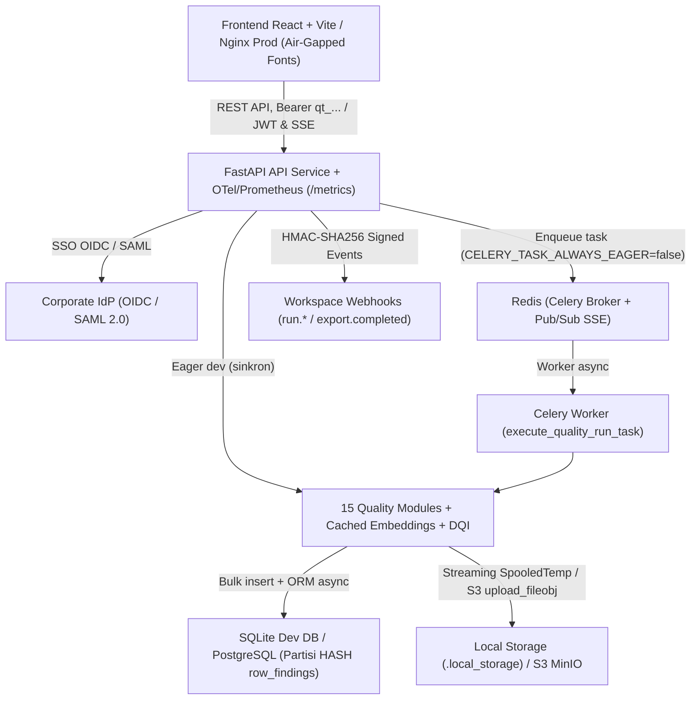
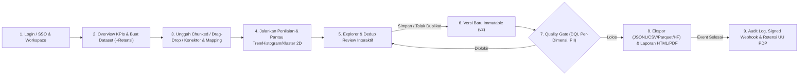

# REPORT.md: Ringkasan Sistem, Panduan Operasional, Catatan Milestone & Rencana Pengembangan QualiText

Dokumen ini menyajikan kondisi teknis terkini platform **QualiText** berdasarkan kode sumber dan verifikasi otomatis pada **22 November 2026**. Dokumen ini mencakup ringkasan eksekutif, arsitektur aktual, panduan operasional, inventaris modul kualitas (A sampai G), matriks kepatuhan terhadap [CLAUDE.md](CLAUDE.md), **catatan lengkap seluruh milestone yang telah diselesaikan (Fase 0 hingga Tahap 4, Hotfix Pasca-Tahap 4, Audit Logika Kode `LOGIC-01`–`LOGIC-14` & Automated E2E Testing Playwright)**, serta **rencana pengembangan ke depan (Tahap 5+)**.

---

## 1. Ringkasan Eksekutif & Status Verifikasi Terkini

**Verdict Teknis:** QualiText telah menuntaskan seluruh milestone pengembangan aplikasi dari **Fase 0 (Fondasi)**, **Tahap 1 (P0 Hotfix & Security Blockers)**, **Tahap 2 (MVP P0 & Arsitektur Worker/Skala)**, **Tahap 3 (v1.0 P1 & Enterprise Readiness)**, **Tahap 4 (Pasca-v1.0 P2, Kepatuhan UU PDP & Benchmark Sintetis)**, **Audit Logika Full-Stack (`LOGIC-01`–`LOGIC-14`) & Automated E2E Testing Playwright**, hingga **Ekstensi Kualitas Linguistik (Perplexity/OOV), Verifikasi VLM PDF, Semantic Chunking RAG & Generator QA/SFT (Milestone 7)**.

### Hasil Verifikasi Otomatis & Benchmark Terkini
Seluruh pemeriksaan statis, pengujian regresi, build produksi, dan benchmark model sintetis lulus (`exit code 0`):
- **Dependency Lock:** `uv lock --offline --check` bersih (`78 packages` tersinkronisasi dengan [uv.lock](backend/uv.lock)).
- **Backend Lint & Format:** `ruff check .` bersih; `ruff format --check .` bersih (`94 files already formatted`).
- **Backend Type-Check:** `mypy --strict app/core app/modules` bersih (`33 source files`).
- **Frontend Lint, Type-Check & Build:** `eslint .` bersih; `tsc --noEmit` bersih; `npm run build` (`tsc -b && vite build`) lulus mentransformasi `1659` modul ke bundle produksi (`dist/` dalam `4.90s`).
- **Backend Tests (`pytest -v`):** **57 passed** di 11 file uji (`44.02s`):
  - [test_audit_logic_fixes.py](backend/tests/test_audit_logic_fixes.py) (9 tes — regresi audit logika `LOGIC-01` s.d. `LOGIC-14`)
  - [test_auth_and_health.py](backend/tests/test_auth_and_health.py) (7 tes)
  - [test_fase1_pipeline.py](backend/tests/test_fase1_pipeline.py) (1 tes)
  - [test_fase2_v1.py](backend/tests/test_fase2_v1.py) (1 tes)
  - [test_fase3_p2.py](backend/tests/test_fase3_p2.py) (2 tes)
  - [test_nlp_vlm_rag_sft_extensions.py](backend/tests/test_nlp_vlm_rag_sft_extensions.py) (5 tes — kualitas linguistik B7, verifikasi VLM PDF D6, semantic chunking + `rag_vector`, dan sintesis QA/SFT + `sft_chat`)
  - [test_pdf_and_ai_repair.py](backend/tests/test_pdf_and_ai_repair.py) (1 tes)
  - [test_stage1_security_and_hotfixes.py](backend/tests/test_stage1_security_and_hotfixes.py) (6 tes)
  - [test_stage2_mvp_and_scale.py](backend/tests/test_stage2_mvp_and_scale.py) (7 tes)
  - [test_stage3_enterprise_and_v1.py](backend/tests/test_stage3_enterprise_and_v1.py) (11 tes)
  - [test_stage4_p2_and_benchmarks.py](backend/tests/test_stage4_p2_and_benchmarks.py) (7 tes)
- **Frontend Tests (`vitest --run`):** **8 test files, 23 tests passed** (`6.20s`):
  - [AuditLogicFixes.test.tsx](frontend/tests/AuditLogicFixes.test.tsx) (6 tes — regresi audit logika UI)
  - [AppShell.test.tsx](frontend/tests/AppShell.test.tsx) (1 tes)
  - [NlpRagVlmExtensions.test.tsx](frontend/tests/NlpRagVlmExtensions.test.tsx) (2 tes — modal Pipeline NLP/RAG, VLM PDF, Semantic Chunking, QA/SFT, kartu RunsPage, dan ekspor `rag_vector`/`sft_chat`)
  - [ScoreCard.test.tsx](frontend/tests/ScoreCard.test.tsx) (1 tes)
  - [Stage1Hotfixes.test.tsx](frontend/tests/Stage1Hotfixes.test.tsx) (2 tes)
  - [Stage2MvpAndI18n.test.tsx](frontend/tests/Stage2MvpAndI18n.test.tsx) (3 tes)
  - [Stage3EnterpriseAndV1.test.tsx](frontend/tests/Stage3EnterpriseAndV1.test.tsx) (5 tes)
  - [Stage4P2Features.test.tsx](frontend/tests/Stage4P2Features.test.tsx) (3 tes)
- **Playwright Automated E2E Tests (`npm run test:e2e`, Chromium headless):** **11 passed** (`1.2m`) di [qualitext.e2e.spec.ts](frontend/e2e/qualitext.e2e.spec.ts) dengan konfigurasi [playwright.config.ts](frontend/playwright.config.ts) (seluruh 10 skenario Milestone 6 ditambah Skenario 11 untuk kualitas linguistik B7, verifikasi VLM PDF D6, semantic chunking + ekspor `rag_vector`, dan sintesis QA/SFT + ekspor `sft_chat`).
- **Benchmark Sintetis ([benchmark_models.py](backend/scripts/benchmark_models.py), [docs/benchmarks.md](docs/benchmarks.md)):**
  - **Deteksi PII Indonesia (`B1`):** Recall **`1.0000`** (target `>= 0.95`), Precision **`1.0000`**, F1 **`1.0000`** (`12` positif sintetis, `6` negatif; `tp=12`, `fp=0`, `fn=0`, `tn=6`).
  - **Deduplikasi Eksak & Semantik (`C1`, `C2`):** Precision **`1.0000`** (target `>= 0.90`), Recall **`1.0000`** (`12` baris sintetis, `4` duplikat; `tp=4`, `fp=0`, `fn=0`).
  - **Streaming Ingesti JSONL (`A1`, `PERF-01`):** **`49,698.88` baris/detik** (`5.000` baris SFT / `1.025.000` byte dalam `0.1006` detik).

---

## 2. Arsitektur Aktual & Alur Penggunaan (User Journey)

Platform mendukung **mode *fast-dev* eager** (`CELERY_TASK_ALWAYS_EAGER=true`) maupun **eksekusi asinkron lewat Celery + Redis pub/sub** (`CELERY_TASK_ALWAYS_EAGER=false`) melalui [tasks.py](backend/app/workers/tasks.py), stream SSE real-time di [runs.py](backend/app/api/v1/runs.py), observabilitas Prometheus/OpenTelemetry di [observability.py](backend/app/core/observability.py), serta dispatch Webhooks HMAC di [webhook_service.py](backend/app/services/webhook_service.py).

### Alur Pengguna End-to-End (User Journey)

1. **Masuk, SSO & Workspace:** Pengguna login dengan email/password (autofill demo hanya aktif saat `import.meta.env.DEV`) atau tombol SSO OIDC/SAML pada [LoginPage.tsx](frontend/src/app/LoginPage.tsx). Top bar di [AppShell.tsx](frontend/src/app/AppShell.tsx) menyediakan pemilih workspace, pengalih bahasa (`id`/`en`), mode terang/gelap, serta **CommandPalette (`Ctrl+K` / `Cmd+K`)**.
2. **Overview Workspace Live:** [OverviewPage.tsx](frontend/src/app/OverviewPage.tsx) menampilkan KPI live dari `GET /workspaces/{id}/overview` (total dataset, rata-rata DQI, PII kritis terbuka, run aktif, grafik `DqiTrendChart`, dan daftar **Dataset Perlu Perhatian**).
3. **Buat Dataset, Unggah, Konektor & Hapus (UU PDP):** Di [DatasetsPage.tsx](frontend/src/features/datasets/DatasetsPage.tsx), buat dataset (`sft`, `preference`, `rag`, `raw`) dengan opsi `retention_days`, unggah berkas via *file picker* atau **drag-and-drop** (chunked `> 5 MB`) atau **Impor Konektor** (`S3`, `SQL Read-Only`, `SharePoint HTTPS` khusus Admin), petakan kolom termasuk `chosen`/`rejected` (`GET/PUT /mapping`), unduh daftar error validasi (CSV/JSON), atau hapus dataset beserta seluruh artefaknya (hak hapus UU PDP).
4. **Laporan Run, Klaster 2D & PDF:** Di [RunsPage.tsx](frontend/src/features/runs/RunsPage.tsx), tinjau `ScoreCard` (klik dimensi ke Explorer), `DimensionBreakdownChart`, histogram token 6 bucket (A5), visualisasi **Klaster Topik 2D** (`ClusterScatterChart`), tren DQI (`DqiTrendChart`), serta tombol **Unduh Laporan HTML** dan **Unduh Laporan PDF**.
5. **Explorer, Kurasi & Dedup Review (`US-5`):** Di [ExplorerPage.tsx](frontend/src/features/explorer/ExplorerPage.tsx), PII tersamar default dengan `HighlightedText`, paginasi server (`25/50/100/200`), densitas 40px/32px, `DiffViewer`, editor SFT + AI Repairing, dan pintasan keyboard (`J/K`, `A`, `R`, `F`, `?`). Di [DedupReviewPage.tsx](frontend/src/features/dedup/DedupReviewPage.tsx), sesuaikan slider threshold kemiripan (`50%-99%`) dan tolak duplikat dengan 1 klik ke versi immutable baru (`v2`).
6. **Kebijakan, Audit & Pengaturan Enterprise:** Di [PoliciesPage.tsx](frontend/src/features/policies/PoliciesPage.tsx), atur `min_dqi`, `critical_cap`, dan ambang minimum per dimensi. Di [AuditLogsPage.tsx](frontend/src/features/audit/AuditLogsPage.tsx), filter aksi sensitif dan ekspor CSV/JSON. Di [SettingsPage.tsx](frontend/src/features/settings/SettingsPage.tsx), kelola **Token API (`qt_...`)**, **Webhook HMAC (`whsec_...`)**, **SSO Korporat**, **Benchmark Kontaminasi**, dan **Retensi UU PDP**.

---

## 3. Inventaris Modul Kualitas & Status Implementasi (A sampai G)

Seluruh 17 modul di `MODULE_REGISTRY` ([run_service.py](backend/app/services/run_service.py)) mengimplementasikan kontrak `QualityModule` ([base.py](backend/app/modules/base.py)).

| ID | Modul & File Utama | Dimensi DQI | Status | Kapabilitas Terimplementasi |
|---|---|---|---|---|
| **A1-A4** | **Streaming Parser & Validator** ([validator.py](backend/app/modules/ingestion/validator.py)) | Validitas Struktur | `Lengkap` | Streaming `parse_and_validate_stream` baris-demi-baris (`jsonl`, `csv`, `txt`, `md`) + `parquet` & `pdf` (`pypdf`), validasi magic-bytes (`validate_content_magic`), template `messages`, `prompt/response`, kolom eksplisit `chosen`/`rejected`, dan pemetaan kolom kustom. |
| **A5** | **Token Analytics** ([token_analytics.py](backend/app/modules/ingestion/token_analytics.py)) | Validitas Struktur | `Lengkap (Hook)` | Pemrosesan batch (`collect_batches`), `avg_tokens`, `p50`, `p95`, `p99`, `max_tokens_observed`, 6 bucket histogram (`hist_0_128` hingga `hist_gt_4096`), `TOKEN_TRUNCATION_RISK`, dan hook tokenizer `tiktoken:`/`hf:`. |
| **A6** | **Data Connectors** ([connectors.py](backend/app/modules/ingestion/connectors.py), [connectors API](backend/app/api/v1/connectors.py)) | Ingesti | `Lengkap` | `S3Connector` (storage key tanpa traversal), `DatabaseConnector` (SQLite `?mode=ro` read-only + validasi tabel/`SELECT` anti-mutasi), dan `SharePointConnector` (HTTPS + OAuth Bearer `QUALITEXT_*` + anti-SSRF) via `/import-connector` khusus Admin. |
| **B1, B2, B6** | **PII Indonesia & Masking** ([pii.py](backend/app/modules/cleaning/pii.py)) | Kebersihan & Privasi | `Lengkap (Recall 1.0)` | Deteksi non-overlapping `PII_NIK`, `PII_NPWP`, `PII_PHONE_ID` (`+62`/`08`), `PII_EMAIL`, `PII_BANK_ACCOUNT` (rekening/VA/kartu), `PII_PERSON`, dan `PII_ADDRESS`; mode `detect_only`, `mask`, `hash`, `drop_row`, serta `DiffViewer`. |
| **B3** | **Artifact Cleaning** ([artifacts.py](backend/app/modules/cleaning/artifacts.py)) | Kebersihan & Privasi | `Lengkap` | Pemrosesan per batch; deteksi & pembersihan HTML, *zero-width characters*, *mojibake*, dan normalisasi Unicode NFKC (`clean_text_artifacts`). |
| **B4** | **Language Detection** ([language.py](backend/app/modules/cleaning/language.py)) | Kebersihan & Privasi | `Siap (Heuristik)` | Klasifikasi per baris (`id`, `en`, `mixed`, `unknown`) dan konsistensi bahasa korpus (`LANG_MISMATCH`). |
| **B5** | **Toxicity Filter** ([toxicity.py](backend/app/modules/cleaning/toxicity.py)) | Keamanan & Bias | `Siap (Leksikon)` | Pemindaian kata kasar/toksisitas bahasa Indonesia dan Inggris (`TOXIC_LANGUAGE`). |
| **B7** | **Linguistic Quality** ([linguistic.py](backend/app/modules/cleaning/linguistic.py), [lexicon.py](backend/app/modules/cleaning/lexicon.py)) | Kebersihan & Privasi | `Lengkap (Hybrid)` | *Perplexity* character n-gram LM (dengan hook opsional `kenlm` / `hf`), deteksi kata valid vs OOV memakai stemmer + leksikon ID/EN/teknis, dan deteksi noise OCR/gibberish (`HIGH_PERPLEXITY`, `HIGH_OOV_RATIO`, `OCR_GIBBERISH_NOISE`). |
| **C1** | **Exact & Near Dedup** ([dedup.py](backend/app/modules/semantic/dedup.py)) | Keunikan & Keberagaman | `Lengkap` | Deduplikasi eksak SHA-256 (`DUP_EXACT`) dan near-dedup MinHash 32-perm / LSH 8-band deterministik via `blake2b` (`DUP_NEAR`). |
| **C2** | **Semantic Dedup** ([semantic_dedup.py](backend/app/modules/semantic/semantic_dedup.py), [embeddings.py](backend/app/modules/semantic/embeddings.py)) | Keunikan & Keberagaman | `Lengkap (Hybrid)` | Bounded LRU embedding cache (`50.000` entri), hook `sentence-transformers` & `faiss`/`pgvector` dengan fallback deterministik `local_hash` + multi-table SimHash LSH, pemilihan kanonik terpanjang, dan UI [DedupReviewPage.tsx](frontend/src/features/dedup/DedupReviewPage.tsx). |
| **C3-C4** | **Topic Clustering & N-gram** ([clustering.py](backend/app/modules/semantic/clustering.py)) | Keunikan & Keberagaman | `Lengkap` | K-means sferis, proyeksi 2D PCA (`project_vectors_2d`), kata kunci teratas tersamar PII, `cluster_entropy`, `NGRAM_REPETITION` intra-baris, dan `cross_row_ngram_overlap_ratio` lintas baris (`ClusterScatterChart`). |
| **C5** | **Benchmark Contamination** ([contamination.py](backend/app/modules/semantic/contamination.py), [benchmarks.py](backend/app/api/v1/benchmarks.py)) | Keunikan & Keberagaman | `Lengkap` | Manajemen `BenchmarkSet` per workspace (CRUD + unggah `.jsonl`/`.txt`), injeksi otomatis di `run_service`, deteksi overlap 6-gram & kemiripan kosinus via `embed_texts` (`BENCHMARK_CONTAMINATION`). |
| **D1, D3** | **Complexity & Format** ([complexity_and_format.py](backend/app/modules/instruction/complexity_and_format.py)) | Kualitas Instruksi-Respons | `Lengkap` | Klasifikasi kompleksitas (`simple`/`moderate`/`complex`), deteksi blok kode tak tertutup (`UNCLOSED_CODE_BLOCK`), dan validasi JSON respons (`INVALID_JSON_RESPONSE`). |
| **D2** | **LLM-as-a-Judge** ([llm_judge.py](backend/app/modules/instruction/llm_judge.py)) | Kualitas Instruksi-Respons | `Lengkap` | Endpoint kompatibel OpenAI terproteksi `is_local_llm_url`, shared `httpx.Client`, rubrik & `criteria_weights` kustom (`rubric_hash`), serta sampling deterministik berbasis `seed`. |
| **D4** | **RLHF Preference** ([preference.py](backend/app/modules/instruction/preference.py)) | Kualitas Instruksi-Respons | `Lengkap` | Membaca kolom eksplisit `chosen`/`rejected` (atau fallback `messages_json`), mendeteksi `PREF_PAIR_INCOMPLETE`, `PREF_PAIR_IDENTICAL`, `PREF_PAIR_NEAR_DUPLICATE`, dan `PREF_PAIR_LENGTH_ANOMALY` (`preference_consistency_ratio`). |
| **D5** | **RAG Chunk Quality & Semantic Chunker** ([rag_quality.py](backend/app/modules/instruction/rag_quality.py), [semantic_chunker.py](backend/app/modules/ingestion/semantic_chunker.py)) | Kualitas Instruksi-Respons | `Lengkap` | Penilaian kelayakan chunk RAG (`RAG_CHUNK_*`) plus *automatic semantic chunking* berbasis embedding segmen dan *metadata enrichment* bebas PII untuk Vector DB. |
| **D6** | **VLM PDF Verifier & QA/SFT Synthesizer** ([vlm_verifier.py](backend/app/modules/instruction/vlm_verifier.py), [qa_synthesizer.py](backend/app/modules/instruction/qa_synthesizer.py)) | Kualitas Instruksi-Respons | `Lengkap (Hybrid)` | Verifikasi ekstraksi teks & tabel PDF terhadap struktur visual/gambar halaman (`VLM_SCANNED_PAGE_LOW_TEXT`, `VLM_TABLE_STRUCTURE_MISMATCH`, hook VLM OpenAI-compatible lokal), serta sintesis otomatis pasangan QA/SFT (`local_template` maupun LLM lokal). |
| **E1** | **Bias Scanner** ([bias.py](backend/app/modules/safety/bias.py)) | Keamanan & Bias | `Lengkap` | Pemindaian stereotip ID & EN across 4 kategori (`gender_stereotype`, `ethnic_religion_bias`, `socioeconomic_bias`, `age_disability_bias`) beserta rincian metrik per kategori. |
| **E2-E3** | **Hallucination, Harmful & Injection** ([hallucination_and_injection.py](backend/app/modules/safety/hallucination_and_injection.py)) | Keamanan & Bias | `Lengkap` | Deteksi `PROMPT_INJECTION_RISK`, taksonomi berbahaya `HARMFUL_CONTENT_RISK` (`cyber_exploitation`, `self_harm_instruction`), dan `HALLUCINATION_RISK` via heuristik maupun hook opt-in LLM-judge lokal. |
| **F1-F8** | **DQI, Explorer, Kurasi, Compare, Export, Report & Policy** ([dqi.py](backend/app/scoring/dqi.py), [curation_service.py](backend/app/services/curation_service.py), [export_service.py](backend/app/services/export_service.py), [report_service.py](backend/app/services/report_service.py)) | Lintas Dimensi | `Lengkap` | Penyelarasan metrik eksplisit DQI (`ARCH-01`), custom bobot & `critical_cap` workspace, kurasi immutable `v1 -> v2` dengan redaksi PII, ekspor JSONL/CSV/Parquet/Hugging Face `.zip`/`rag_vector`/`sft_chat` + manifest, laporan HTML & PDF 1.4, quality gate per dimensi, dan tren DQI. |
| **G1-G6** | **SSO, RBAC, Workspace, Audit, Tokens, Webhooks, UU PDP & Helm** ([auth.py](backend/app/api/v1/auth.py), [deps.py](backend/app/core/deps.py), [webhooks.py](backend/app/api/v1/webhooks.py), [workspaces.py](backend/app/api/v1/workspaces.py), [deploy/helm/qualitext](deploy/helm/qualitext/Chart.yaml)) | Platform & Governance | `Lengkap` | JWT + rotasi refresh token (`SEC-05`), rate limiter login, SSO OIDC & SAML 2.0, token `qt_...` ter-scope, Webhooks HMAC anti-SSRF, audit log + ekspor CSV/JSON (`SEC-04`), hak hapus & retensi UU PDP, Nginx prod Dockerfile, dan 11 template Helm. |

---

## 4. Catatan Lengkap Milestone yang Sudah Dikerjakan

Seluruh tahapan pengerjaan di bawah ini telah diimplementasikan pada kode sumber, dilindungi oleh pengujian otomatis, dan dicatat pada [docs/progress.md](docs/progress.md).

### Milestone 0: Fase 0 hingga Baseline Awal & Ekstensi PDF/AI Repairing (`SELESAI`)
- **Fondasi Monorepo & Infrastruktur Lokal:** Struktur `backend/` (FastAPI, SQLAlchemy 2.0 async, Alembic, Polars, structlog) dan `frontend/` (React 18, TypeScript strict, Vite, Tailwind CSS, TanStack Query, Zustand), dilengkapi [Makefile](Makefile), [docker-compose.yml](docker-compose.yml), [ADR-001](docs/adr/001-architecture-and-local-fast-dev.md), [ADR-002](docs/adr/002-open-embedding-and-llm-placeholder.md), dan [docs/dqi.md](docs/dqi.md).
- **Autentikasi, RBAC 5 Role & Storage:** Login JWT, matriks izin 5 peran (`admin`, `governance`, `curator`, `analyst`, `viewer`), abstraksi penyimpanan objek (`LocalStorageBackend` dan `S3StorageBackend` di [s3.py](backend/app/storage/s3.py)), serta migrasi [0001_initial_foundation.py](backend/alembic/versions/0001_initial_foundation.py) dan [0002_fase1_mvp_tables.py](backend/alembic/versions/0002_fase1_mvp_tables.py).
- **Ekstensi Ingesti PDF/Markdown & AI Repairing:** Ekstraksi dokumen `.pdf` (`pypdf`) dan `.md` per paragraf di [validator.py](backend/app/modules/ingestion/validator.py), serta layanan perbaikan artefak PDF (`-\n`, baris patah, karakter zero-width) via `local_heuristic` maupun endpoint LLM lokal di [repair_service.py](backend/app/services/repair_service.py) ([test_pdf_and_ai_repair.py](backend/tests/test_pdf_and_ai_repair.py)).

### Milestone 1: Tahap 1 - P0 Hotfix & Security Blockers (`SELESAI`)
- **`OPS-01` (Runtime Dependency Fix):** Memindahkan `httpx` dari grup `dev` ke `dependencies` utama di [pyproject.toml](backend/pyproject.toml) dan menyinkronkan [uv.lock](backend/uv.lock) agar container produksi tidak gagal saat startup.
- **`SEC-01` & `BUG-04` (Redaksi PII pada Audit Kurasi & Versi Hasil):** Menambahkan `_build_redacted_snapshot` di [curation_service.py](backend/app/services/curation_service.py) sehingga `curation_actions.old_value` dan `new_value` selalu dimasking sebelum disimpan ke database, serta mengisi `resulting_version_id` dengan ID versi baru (`v2`).
- **`SEC-02` & `SEC-03` (Proteksi IDOR & Penegakan Quality Gate):** Memvalidasi kepemilikan `v2.dataset_id` pada `compare_versions` ([curation.py](backend/app/api/v1/curation.py)) dan `ver.dataset_id == dataset_id` pada `complete_upload` ([datasets.py](backend/app/api/v1/datasets.py)); membatasi `bypass_policy` hanya untuk pemilik izin `policy:manage` dan memblokir ekspor (`409 QUALITY_GATE_NO_RUN`) bila `min_dqi > 0` tetapi versi belum pernah dinilai ([export_service.py](backend/app/services/export_service.py)).
- **`BUG-01`, `BUG-02`, `BUG-03` & `BUG-05` (Keamanan Laporan HTML, Editor SFT & Determinisme):** Mengubah unduhan laporan HTML di [RunsPage.tsx](frontend/src/features/runs/RunsPage.tsx) agar memakai `fetch()` terautentikasi + Blob URL; menerapkan `html.escape(..., quote=True)` di [report_service.py](backend/app/services/report_service.py) untuk mencegah XSS; menyediakan input `Prompt` dan `Response` terpisah saat mengedit baris SFT di [ExplorerPage.tsx](frontend/src/features/explorer/ExplorerPage.tsx); mengganti `hash()` bawaan Python dengan `hashlib.blake2b` di [dedup.py](backend/app/modules/semantic/dedup.py); dan menjaga severity `critical` untuk PII di [pii.py](backend/app/modules/cleaning/pii.py).
- **Verifikasi Regresi Tahap 1:** Ditambahkan 6 tes di [test_stage1_security_and_hotfixes.py](backend/tests/test_stage1_security_and_hotfixes.py) dan 2 tes di [Stage1Hotfixes.test.tsx](frontend/tests/Stage1Hotfixes.test.tsx).

### Milestone 2: Tahap 2 - Penuntasan MVP P0 & Arsitektur Worker/Skala (`SELESAI`)
- **Arsitektur Worker Celery, SSE Pub/Sub & Skalabilitas (`PERF-01`):** Mengimplementasikan Celery task `execute_quality_run_task` dan Redis pub/sub progress di [tasks.py](backend/app/workers/tasks.py); streaming upload chunked & direct memakai `SpooledTemporaryFile` + `storage.put_file`; bulk insert `RowFindingRecord` per batch `1.000` baris di [run_service.py](backend/app/services/run_service.py); penghapusan N+1 query pada `list_datasets`; pemrosesan batch `collect_batches` pada modul A5/B1/B3; serta migrasi [0003_fase2_row_findings_partitioning.py](backend/alembic/versions/0003_fase2_row_findings_partitioning.py) untuk partisi HASH deklaratif PostgreSQL pada `row_findings`.
- **Penuntasan Fitur P0 (Modul A sampai F):** Ekspor format **Hugging Face Dataset** (`.zip` berisi `data.jsonl`, `dataset_info.json`, `README.md`, `manifest.json` lengkap dengan `seed` & `config_snapshot`) dan endpoint `GET /exports/{id}`; UI Pemetaan Kolom (`A4`) dan tabel + unduhan CSV/JSON Error Validasi (`A3`/`US-1`) serta drag-and-drop upload (`A1`) di [DatasetsPage.tsx](frontend/src/features/datasets/DatasetsPage.tsx); histogram panjang token 6 bucket + hook `tiktoken`/`hf` (`A5`); serta recognizer `PII_PERSON`/`PII_ADDRESS` dan aksi kurasi `hash_pii`/`drop_row` (`B1`, `B2`).
- **UI Explorer Virtualisasi, Pintasan Keyboard & i18n Penuh (`F2`, `F3`, `3.6`):** Komponen [VirtualizedDataTable.tsx](frontend/src/components/shared/VirtualizedDataTable.tsx) (densitas 40px/32px), [HighlightedText.tsx](frontend/src/components/shared/HighlightedText.tsx), [DiffViewer.tsx](frontend/src/components/shared/DiffViewer.tsx), pintasan keyboard (`J/K`, `A`, `R`, `F`, `?`), serta lokalisasi penuh Bahasa Indonesia (`id.json`) dan Inggris (`en.json`).
- **Verifikasi Regresi Tahap 2:** Ditambahkan 7 tes di [test_stage2_mvp_and_scale.py](backend/tests/test_stage2_mvp_and_scale.py) dan 3 tes di [Stage2MvpAndI18n.test.tsx](frontend/tests/Stage2MvpAndI18n.test.tsx).

### Milestone 3: Tahap 3 - Penuntasan v1.0 (P1) & Enterprise Readiness (`SELESAI`)
- **Keamanan Auth, Token Ter-scope, SSO & Webhooks (`G1`, `G4`, `G5`, `SEC-04`, `SEC-05`):**
  - Migrasi [0004_stage3_enterprise_tables.py](backend/alembic/versions/0004_stage3_enterprise_tables.py) (`refresh_token_sessions`, `webhook_subscriptions`, `webhook_deliveries`).
  - Autentikasi Bearer API Token `qt_...` di [deps.py](backend/app/core/deps.py) dengan penegakan scope ketat (`check_api_token_scope`, termasuk `pii:view` dan `export:create`).
  - Rotasi refresh token satu-kali-pakai dengan deteksi reuse famili token & endpoint `POST /auth/logout` ([auth.py](backend/app/api/v1/auth.py)).
  - Sliding-window rate limiter login ([rate_limit.py](backend/app/core/rate_limit.py)), penolakan `SECRET_KEY` lemah di `production` ([config.py](backend/app/core/config.py)), validasi URL LLM lokal via `urlparse` (`is_local_llm_url` di [security.py](backend/app/core/security.py)), dan pembatasan tombol autofill demo hanya pada `import.meta.env.DEV` ([LoginPage.tsx](frontend/src/app/LoginPage.tsx)).
  - Integrasi Corporate SSO **OIDC** (authorize, callback, JWKS/HS256, JIT provisioning) dan **SAML 2.0** (SP metadata, login redirect, ACS POST dengan verifikasi HMAC & proteksi anti-XXE `defusedxml`) di [sso_service.py](backend/app/services/sso_service.py).
  - **Webhooks** ber-signature HMAC-SHA256 (`X-QualiText-Signature`) dengan guard anti-SSRF (`is_safe_webhook_url`) di [webhook_service.py](backend/app/services/webhook_service.py) dan [webhooks.py](backend/app/api/v1/webhooks.py).
  - Audit log lengkap dengan `ip_address` (`extract_client_ip`), filter `action`/`target_type`, alias `GET /api/v1/audit-logs`, dan ekspor CSV/JSON aman dari CSV injection.
- **Kedalaman Semantik, LLM-Judge, Bias, Laporan PDF & Quality Gate (`C2`, `C3`, `C4`, `D2`, `E1`, `F6`, `F7`, `F8`):**
  - Bounded LRU embedding cache (`50.000` entri), hook `sentence-transformers` & `faiss`/`pgvector` + fallback SimHash LSH, pemilihan baris kanonik terpanjang, dan endpoint `/dedup-preview` + halaman [DedupReviewPage.tsx](frontend/src/features/dedup/DedupReviewPage.tsx).
  - Proyeksi 2D PCA (`project_vectors_2d`), `cross_row_ngram_overlap_ratio`, masking PII pada preview & `top_terms` klaster, serta grafik SVG [ClusterScatterChart.tsx](frontend/src/components/shared/ClusterScatterChart.tsx), [DqiTrendChart.tsx](frontend/src/components/shared/DqiTrendChart.tsx), dan [DimensionBreakdownChart.tsx](frontend/src/components/shared/DimensionBreakdownChart.tsx).
  - Rubrik kustom & `criteria_weights` + sampling ber-seed pada [llm_judge.py](backend/app/modules/instruction/llm_judge.py), pemindaian bias 4 kategori ID/EN pada [bias.py](backend/app/modules/safety/bias.py), generator laporan **PDF 1.4** (`GET /runs/{id}/report.pdf`) di [report_service.py](backend/app/services/report_service.py), serta penegakan ambang kualitas per dimensi (`dimension_thresholds`), `critical_cap`, dan `dimension_weights` workspace.
- **Infrastruktur Produksi, Observabilitas & CI (`G6`, `1.7`, `2.11`):**
  - Multi-stage Nginx production build di [frontend/Dockerfile](frontend/Dockerfile) & [nginx.conf](frontend/nginx.conf); 11 template Kubernetes di [deploy/helm/qualitext/templates](deploy/helm/qualitext/templates/api-deployment.yaml) (API/Worker/Frontend Deployments, HPA, Ingress, ConfigMap, Secret, ServiceMonitor).
  - Probe `/readyz` aktual (DB, Storage, Redis), endpoint `/metrics` Prometheus, tracing OpenTelemetry ([observability.py](backend/app/core/observability.py)), serta workflow CI keamanan (`pip-audit`, `npm audit`, Trivy) dan aksesibilitas Playwright + `axe-core` ([ci.yml](.github/workflows/ci.yml), [smoke.a11y.spec.mjs](frontend/e2e/smoke.a11y.spec.mjs)).
- **Verifikasi Regresi Tahap 3:** Ditambahkan 11 tes di [test_stage3_enterprise_and_v1.py](backend/tests/test_stage3_enterprise_and_v1.py) dan 5 tes di [Stage3EnterpriseAndV1.test.tsx](frontend/tests/Stage3EnterpriseAndV1.test.tsx).

### Milestone 4: Tahap 4 - Pendalaman Pasca-v1.0 (P2), UU PDP & Benchmark Model (`SELESAI`)
- **Migrasi `0005`, Konektor Admin-Gated (`A6`), Benchmark Kontaminasi (`C5`) & UU PDP (`2.9`):**
  - Migrasi [0005_stage4_p2_retention_and_benchmarks.py](backend/alembic/versions/0005_stage4_p2_retention_and_benchmarks.py) menambahkan `datasets.retention_days` dan tabel `benchmark_sets`.
  - Implementasi penuh `DatabaseConnector` (ekstraksi SQLite read-only `?mode=ro` dengan validasi identifier tabel & query `SELECT` anti-mutasi ke JSONL) dan `SharePointConnector` (HTTPS + OAuth Bearer `QUALITEXT_*` + guard anti-SSRF) di [connectors.py](backend/app/modules/ingestion/connectors.py), diekspos melalui `POST /api/v1/datasets/{id}/versions/import-connector` yang hanya diizinkan bagi Admin (`POLICY_MANAGE` + `DATASET_WRITE`) dengan pencatatan URI tersanitasi di [connectors.py (API)](backend/app/api/v1/connectors.py).
  - Endpoint CRUD & unggah berkas benchmark (`GET/POST/DELETE /workspaces/{id}/benchmarks*`, `POST .../benchmarks/upload`) di [benchmarks.py](backend/app/api/v1/benchmarks.py) yang otomatis dimuat oleh [run_service.py](backend/app/services/run_service.py) saat modul `contamination` dijalankan.
  - Hak hapus UU PDP (`DELETE /api/v1/datasets/{id}`) yang menghapus seluruh versi, run, temuan, ekspor, dan objek fisik di storage ([dataset_service.py](backend/app/services/dataset_service.py)), ditambah kebijakan retensi workspace (`GET/PUT /workspaces/{id}/retention`) dan pembersihan dataset kedaluwarsa (`POST /workspaces/{id}/retention/purge` di [workspaces.py](backend/app/api/v1/workspaces.py)).
- **Streaming Validator, Kolom Preferensi, Upgrade Modul P2 & Penyelarasan DQI (`A1`, `D4`, `D5`, `E2`, `E3`, `ARCH-01`):**
  - `validate_content_magic` (menolak berkas biner/PDF/Parquet palsu) dan `parse_and_validate_stream` (parsing baris-demi-baris tanpa memuat seluruh byte ke RAM, sekaligus mengekstrak kolom eksplisit `chosen` dan `rejected`) di [validator.py](backend/app/modules/ingestion/validator.py).
  - Peningkatan [preference.py](backend/app/modules/instruction/preference.py) (`PREF_PAIR_NEAR_DUPLICATE`, `PREF_PAIR_LENGTH_ANOMALY`), [rag_quality.py](backend/app/modules/instruction/rag_quality.py) (`RAG_CHUNK_LOW_ENTROPY`, `RAG_CHUNK_CONTEXT_DUPLICATE`), [hallucination_and_injection.py](backend/app/modules/safety/hallucination_and_injection.py) (taksonomi `HARMFUL_CONTENT_RISK` + hook opt-in LLM-judge lokal kompatibel OpenAI), serta penyelarasan key metrik eksplisit pada [dqi.py](backend/app/scoring/dqi.py).
- **Kalibrasi PII, Font Air-Gapped, UI Enterprise P2 & Benchmark Sintetis (`B1`, `2.13`):**
  - Kalibrasi urutan dan pola recognizer PII Indonesia serta resolusi span non-overlapping di [pii.py](backend/app/modules/cleaning/pii.py); penambahan korpus & benchmark demo sintetis bebas-PII di [seed.py](backend/scripts/seed.py); serta skrip [benchmark_models.py](backend/scripts/benchmark_models.py) dan laporan [docs/benchmarks.md](docs/benchmarks.md).
  - Penghapusan ketergantungan Google Fonts CDN di [index.html](frontend/index.html) untuk deployment *air-gapped*, modal **Impor Konektor** & konfirmasi **Hapus Dataset** di [DatasetsPage.tsx](frontend/src/features/datasets/DatasetsPage.tsx), serta tab **Benchmark Kontaminasi** & **Retensi UU PDP** di [SettingsPage.tsx](frontend/src/features/settings/SettingsPage.tsx).
- **Verifikasi Regresi Tahap 4:** Ditambahkan 7 tes di [test_stage4_p2_and_benchmarks.py](backend/tests/test_stage4_p2_and_benchmarks.py) dan 3 tes di [Stage4P2Features.test.tsx](frontend/tests/Stage4P2Features.test.tsx).

### Milestone 5 / Hotfix Pasca-Tahap 4: Perbaikan Login Pasca-Migrasi, Alembic PostgreSQL & Sinkronisasi CLAUDE.md (20 November 2026 — `SELESAI`)
- **Perbaikan Migrasi PostgreSQL & Login Pasca-Migrasi:** Penambahan `ensure_postgres_version_column_width` di [session.py](backend/app/db/session.py) & [env.py](backend/alembic/env.py) untuk memperlebar `alembic_version.version_num` ke `VARCHAR(128)` (mengatasi revisi `0003` 36-karakter dan `0005` 39-karakter pada PostgreSQL), rename constraint `row_findings_pkey` sebelum pembuatan tabel partisi di [0003_fase2_row_findings_partitioning.py](backend/alembic/versions/0003_fase2_row_findings_partitioning.py), serta migrasi & seeding DB lokal (`qualitext_dev.db` ke `0005_stage4_p2_retention_and_benchmarks`).
- **Observabilitas Error `500` & CORS Loopback:** Pembaruan `handle_unexpected_error` di [errors.py](backend/app/core/errors.py) agar mencatat exception terstruktur tanpa PII dan mempertahankan header CORS pada respons `500`, serta penambahan `http://127.0.0.1:5173` pada `CORS_ORIGINS` di [config.py](backend/app/core/config.py), `.env`, dan [.env.example](.env.example).
- **Verifikasi Regresi:** Penambahan 3 tes baru di [test_auth_and_health.py](backend/tests/test_auth_and_health.py) (login + `/auth/me` + `/overview` pada DB hasil migrasi & seed, verifikasi pelebaran versi PostgreSQL + rename PK `0003`, serta preservasi header CORS saat error `500`).
- **Sinkronisasi [CLAUDE.md](CLAUDE.md):** Pembaruan Bagian `0.4` (`make dev`/`docker-up`), `1.5` (`A1` Markdown/PDF), `2.5` (4 tabel baru + `retention_days` + partisi HASH), `2.8` (peta endpoint terbaru), `2.12` (hardening migrasi PostgreSQL & CORS error `500`), `2.13` (pengisian 5 Keputusan Arsitektur yang sebelumnya terbuka), `3.2`/`3.3` (font air-gapped & menu `Tinjau Duplikat`), serta status Fase 0–3 pada Bagian `4`.

### Milestone 6: Audit Logika Kode (`LOGIC-01`–`LOGIC-14`) & Automated E2E Testing Playwright (22 November 2026 — `SELESAI`)

#### A. Ringkasan 14 Temuan Audit Logika, Perbaikan & Mitigasi ([test_audit_logic_fixes.py](backend/tests/test_audit_logic_fixes.py), [AuditLogicFixes.test.tsx](frontend/tests/AuditLogicFixes.test.tsx))

| ID | File Terkait | Akar Masalah Logika | Perbaikan | Mitigasi |
|---|---|---|---|---|
| **LOGIC-01** | [export_service.py](backend/app/services/export_service.py) | `create_export` diam-diam melewati `dimension_thresholds` saat dimensi terkait belum pernah dijalankan pada `dim_scores`. | Melempar HTTP `409 QUALITY_GATE_DIMENSION_MISSING` jika dimensi yang disyaratkan belum tersedia. | Wajibkan kelengkapan evaluasi seluruh dimensi kebijakan aktif sebelum ekspor. |
| **LOGIC-02** | [connectors.py](backend/app/modules/ingestion/connectors.py) | `SharePointConnector.validate_config` memakai `options["allow_private"]` dari klien (risiko SSRF); `DatabaseConnector` menerima opsi kosong, gagal pada query `SELECT\n` multi-baris, dan dapat membaca file SQLite internal QualiText. | Ambil flag private target hanya dari `get_settings().webhook_allow_private_targets`, validasi query dengan `re.match(r"(?i)^SELECT\s+", clean_query)`, panggil `_build_readonly_sql` di `validate_config`, dan blokir file SQLite `database_url`. | Pisahkan kontrol keamanan SSRF ke konfigurasi server dan terapkan pembatasan read-only serta isolasi DB internal. |
| **LOGIC-03** | [curation_service.py](backend/app/services/curation_service.py), [export_service.py](backend/app/services/export_service.py) | Filter `search` di `list_version_rows` tanpa `reveal_pii` mencari pada teks Parquet mentah (*PII search oracle*); `has_pii` & `block_pii` hanya memeriksa sebagian kolom teks. | Cek `FORBIDDEN_PII_VIEW` sebelum membaca Parquet, jalankan `search` pada teks hasil `apply_pii_transform(..., mode="mask")` + `row_id`, hitung `has_pii` di `text`/`prompt`/`response`, dan pindai seluruh kolom ekspor (`row_id`, `prompt`, `response`, `text`, `chosen`, `rejected`). | Masking PII sebelum pencarian non-privileged dan perluas pemindaian PII ke seluruh kolom teks terstruktur. |
| **LOGIC-04** | [dataset_service.py](backend/app/services/dataset_service.py), [datasets.py](backend/app/api/v1/datasets.py), [workspaces.py](backend/app/api/v1/workspaces.py), [validator.py](backend/app/modules/ingestion/validator.py) | Unggahan gagal menyisakan versi yatim `"uploading"`; chunked upload tidak mengunci status/indeks; versi non-valid tampil sebagai `latest_version`; file PDF/Parquet korup, CSV kelebihan kolom (`None` key), dan preference tanpa `chosen`/`rejected` memicu `500`/salah validasi. | Buat `direct_upload_version` atomik (rollback + hapus storage + simpan scalar `ds_id` agar aman dari `MissingGreenlet`); tegakkan `VERSION_ALREADY_FINALIZED`, `INVALID_CHUNK_INDEX`, `INVALID_CHUNK_COUNT`, `VERSION_DATA_NOT_READY`; filter `validated`/`curated`; tangkap error Parquet/PDF sebagai `ValueError` (`400`), saring key string CSV, dan tegakkan skema `preference`. | Gunakan unggahan atomik dengan cleanup storage dan ubah semua error parsing menjadi respons klien `400`. |
| **LOGIC-05** | [run_service.py](backend/app/services/run_service.py) | `execute_run_by_id` meninggalkan hasil parsial (`RunModuleResult`, `RowFindingRecord`) saat gagal di tengah jalan dan tidak aman untuk retry. | Cache ID skalar sebelum `try:`, hapus hasil parsial lama sebelum eksekusi, dan panggil `await db.rollback()` sebelum menyimpan status `"failed"`. | Jamin batas transaksi run bersifat all-or-nothing dan idempoten ketika dijalankan ulang. |
| **LOGIC-06** | [datasets.py](backend/app/api/v1/datasets.py) | `delete_dataset` hanya menangkap `"FORBIDDEN"` bukan `"INSUFFICIENT_TOKEN_SCOPE"`, memblokir API token `POLICY_MANAGE`. | Tangkap `"FORBIDDEN"` maupun `"INSUFFICIENT_TOKEN_SCOPE"` saat mengecek `DATASET_WRITE` lalu fallback ke `POLICY_MANAGE`. | Selaraskan pengecekan izin role pengguna dan scope token API. |
| **LOGIC-07** | [App.tsx](frontend/src/app/App.tsx), [api.ts](frontend/src/lib/api.ts), [PoliciesPage.tsx](frontend/src/features/policies/PoliciesPage.tsx), [DatasetsPage.tsx](frontend/src/features/datasets/DatasetsPage.tsx), [ExplorerPage.tsx](frontend/src/features/explorer/ExplorerPage.tsx), [SettingsPage.tsx](frontend/src/features/settings/SettingsPage.tsx), [DedupReviewPage.tsx](frontend/src/features/dedup/DedupReviewPage.tsx) | Kebocoran cache `QueryClient` lintas akun/logout; `Content-Type` JSON dipaksa pada `FormData`; `PoliciesPage` menghapus `dimension_weights`; error mutasi/query ditelan; state Explorer tidak di-reset antar versi dan `FORBIDDEN_PII_VIEW` menghapus tabel; input file tidak di-reset. | Bersihkan `queryClient` saat `!accessToken`/`userId` berubah; lewati header JSON untuk `FormData`/`Blob`; pertahankan `dimension_weights`; tambahkan `onError`, `<ErrorState>`, penanganan `FORBIDDEN_PII_VIEW`, reset state versi, `Escape`, `editingRowIdRef`, reset file input, validasi `retention_days >= 1`, dan invalidasi cache. | Kosongkan cache pada pergantian sesi/versi dan tampilkan status kegagalan eksplisit pada seluruh operasi async UI. |
| **LOGIC-08** | [language.py](backend/app/modules/cleaning/language.py) | `expected_language="any"` mengembalikan rasio konsistensi `0.0`. | Kembalikan `lang_consistency_ratio = 1.0` saat `expected_lang == "any"`. | Tangani konfigurasi permisif secara eksplisit sebelum perhitungan penalti baris. |
| **LOGIC-09** | [preference.py](backend/app/modules/instruction/preference.py) | Baris preference tidak lengkap (`chosen` ada, `rejected` kosong) jatuh ke fallback `prompt`/`response`. | Lewati fallback `prompt`/`response` bila kolom preference eksplisit tersedia sehingga `PREF_PAIR_INCOMPLETE` terdeteksi tepat. | Pisahkan validasi kolom preference eksplisit dari jalur fallback agar tidak terjadi salah klasifikasi. |
| **LOGIC-10** | [embeddings.py](backend/app/modules/semantic/embeddings.py), [semantic_dedup.py](backend/app/modules/semantic/semantic_dedup.py), [contamination.py](backend/app/modules/semantic/contamination.py) | Fallback `embed_texts` mencampur dimensi cache `384` dan fallback `64`; skor similarity di luar `[0.0, 1.0]` berisiko error validasi. | Reset batch ke `local_hash` (`64` dim) secara seragam saat encoder gagal; clamp `cosine_similarity` (`[-1.0, 1.0]`) dan `RowFinding.score` (`[0.0, 1.0]`). | Paksakan keseragaman dimensi embedding per batch dan pembatasan rentang skor numerik. |
| **LOGIC-11** | [curation_service.py](backend/app/services/curation_service.py), [curation.py](backend/app/api/v1/curation.py) | `invalid_row_count` versi baru disalin begitu saja setelah `edit`/`drop_row`; `compare_versions` mengabaikan baris terhapus & edit `prompt`/`response`. | Evaluasi ulang validitas pada `edit`, hitung ulang `new_invalid_count` dari `new_df`, serta tampilkan `after_status: "dropped"` dan diff `prompt`/`response`. | Hitung ulang ringkasan metrik versi langsung dari DataFrame hasil kurasi. |
| **LOGIC-12** | [llm_judge.py](backend/app/modules/instruction/llm_judge.py), [complexity_and_format.py](backend/app/modules/instruction/complexity_and_format.py), [export_service.py](backend/app/services/export_service.py), [curation.py](backend/app/api/v1/curation.py), [benchmarks.py](backend/app/api/v1/benchmarks.py), [runs.py](backend/app/api/v1/runs.py), [auth.py](backend/app/api/v1/auth.py), [main.py](backend/app/main.py) | `judge_mode` salah label saat fallback LLM gagal; parser blok JSON sensitif huruf besar; tabrakan `exp_key` & path download; upload benchmark tak dibatasi ukuran baca; race SSE Redis; `logout` melewatkan revoke access token jika refresh token tidak dikenal; ledakan kardinalitas metrik `/metrics` 404. | Catat `judge_mode="llm"` hanya jika panggilan remote berhasil; gunakan regex `re.IGNORECASE \| re.DOTALL`; tambah UUID 8-hex & `storage_key_from_uri`; batasi baca `MAX_BENCHMARK_UPLOAD_BYTES + 1`; re-query `QualityRun` usai subscribe Redis; lacak `revoked_via_refresh`; normalisasi route 404 menjadi `"__unmatched__"`. | Batasi payload I/O streaming, normalkan label metrik observabilitas, dan tutup race kondisi pub/sub & token revocation. |
| **LOGIC-13** | [VirtualizedDataTable.tsx](frontend/src/components/shared/VirtualizedDataTable.tsx), [HighlightedText.tsx](frontend/src/components/shared/HighlightedText.tsx), [DqiTrendChart.tsx](frontend/src/components/shared/DqiTrendChart.tsx) | Tabel virtual kosong setelah penyusutan baris; `[KARTU]` tidak disorot & `/g` `.test()` bermutasi `lastIndex`; potensi OOB `activeIdx` pada grafik tren. | Reset `scrollTop` & clamp `startIdx`; dukung `[KARTU]` dengan regex non-global `PII_TOKEN_EXACT_RE`; jaga `safeIdx < coords.length`. | Lindungi batas indeks komponen visualisasi dan hindari stateful global regex. |
| **LOGIC-14** | [sso_service.py](backend/app/services/sso_service.py) | `_decode_with_jwks` fallback ke kunci pertama bila `kid` tak cocok; OIDC mengabaikan `email_verified=False`; SAML mengabaikan `<Conditions NotOnOrAfter>`. | Tolak JWKS kosong/unknown `kid`; tolak `email_verified is False` (`403 OIDC_EMAIL_UNVERIFIED`); validasi `NotOnOrAfter` (`401 SAML_ASSERTION_EXPIRED`). | Terapkan prinsip *fail-closed* tanpa fallback kunci atau bypass status verifikasi pada jalur SSO. |

#### B. Ringkasan Automated E2E Testing Playwright ([playwright.config.ts](frontend/playwright.config.ts), [qualitext.e2e.spec.ts](frontend/e2e/qualitext.e2e.spec.ts))

Pengujian E2E dijalankan menggunakan **`@playwright/test@1.63.0`** (Chromium headless) dengan `webServer` Playwright yang menyalakan backend (`uvicorn app.main:app --host 127.0.0.1 --port 8001`, `CELERY_TASK_ALWAYS_EAGER=true`) dan frontend (`vite --host 127.0.0.1 --port 5173 --strictPort`) secara terisolasi di atas database SQLite temporer (dibersihkan setelah eksekusi sehingga `backend/qualitext_dev.db` tetap utuh). Seluruh **10/10 skenario E2E lulus (`10 passed (58.1s)`)**:

| # | Nama Skenario Uji ([qualitext.e2e.spec.ts](frontend/e2e/qualitext.e2e.spec.ts)) | Fitur yang Diverifikasi | Status | Durasi |
|---|---|---|---|---|
| **1** | `1. Auth guards, i18n, dark theme, sidebar collapse, and Command Palette` | Tolak password salah, login Admin, switch bahasa `id`/`en`, Dark/Light mode, toggle sidebar, Command Palette (`Ctrl+K`) & `Escape` | `PASSED` | `4.0s` |
| **2** | `2. Workspace Overview KPIs and attention list navigation` | Tampilnya 4 kartu KPI live & navigasi dataset demo dari daftar perhatian ke Explorer | `PASSED` | `1.5s` |
| **3** | `3. Datasets CRUD, magic-bytes guard, column mapping, error downloads, connector SSRF, and delete` | Buat dataset SFT (`retention_days=30`), tolak spoofing `%PDF` sebagai `.jsonl`, unggah JSONL, pemetaan kolom, unduh error `JSON` & `CSV`, tolak konektor `127.0.0.1`, dan hapus dataset 2 langkah | `PASSED` | `4.4s` |
| **4** | `4. Quality Run, ScoreCard, Histogram, 2D Clusters, HTML/PDF reports, and DQI Trend` | Penilaian DQI (`critical_capped`), breakdown dimensi, histogram token `A5`, klaster 2D dengan PII tersamar, unduh `.html` & `.pdf` (`%PDF-1.4`), dan grafik `Tren DQI` di `/reports` | `PASSED` | `3.3s` |
| **5** | `5. Explorer PII masking, search guard, reveal PII, diff, AI repair, shortcuts, and all 4 exports` | Masking PII default, pemblokiran PII *search oracle*, `<mark>` (`[NIK]`, `[EMAIL]`, `[KARTU]`), diff, *Reveal/Samarkan PII*, densitas/filter invalid, AI Repair (`local_heuristic` → `v2`), pintasan (`?`, `j`, `a` → `v3`), blokir ekspor PII terbuka, bulk *Masking PII* (`v4`), run ulang `v4`, serta unduh `JSONL`, `CSV`, `Parquet` (`PAR1`), & `Hugging Face .zip` (`PK`) | `PASSED` | `5.6s` |
| **6** | `6. Semantic Dedup Review threshold slider and duplicate rejection` | Geser threshold kemiripan kosinus via keyboard (`Home` → `50%`) untuk menampilkan kelompok duplikat & kanonik lalu *Tolak Semua Duplikat* ke versi baru | `PASSED` | `1.7s` |
| **7** | `7. Quality Policies persistence and restoration` | Simpan `min_dqi`, `critical_cap`, dan ambang per dimensi, verifikasi persistensi pasca-navigasi, dan kembalikan nilai default | `PASSED` | `1.7s` |
| **8** | `8. Audit Logs filtering and CSV/JSON export` | Filter aksi `policy.update` serta unduh dan verifikasi payload `CSV` dan `JSON` | `PASSED` | `1.4s` |
| **9** | `9. Settings Enterprise tabs: API Tokens, Webhooks, SSO, Benchmarks, and UU PDP Retention` | Buat/cabut API Token (`qt_...`), tolak SSRF webhook + buat/hapus webhook (`whsec_...`), cek status SSO OIDC/SAML, tambah/hapus benchmark kontaminasi, dan simpan/purge retensi UU PDP | `PASSED` | `2.6s` |
| **10** | `10. Multi-role RBAC & cache isolation across Viewer and Governance` | Verifikasi akun `viewer@qualitext.id` ditolak di Audit Log/Webhook/buat Dataset/Reveal PII (tanpa hapus tabel atau kebocoran cache sesi Admin), lalu verifikasi `sari@qualitext.id` (Governance) dapat membuka Audit Log (`pii.reveal`) & Kebijakan | `PASSED` | `24.8s` |

### Milestone 7: Ekstensi Kualitas Linguistik (B7), Verifikasi VLM PDF (D6), Semantic Chunking & Generator QA/SFT (22 November 2026 — `SELESAI`)
- **Analisis Kualitas Linguistik (`B7` — [lexicon.py](backend/app/modules/cleaning/lexicon.py), [linguistic.py](backend/app/modules/cleaning/linguistic.py)):** Menambahkan leksikon dasar Indonesia/Inggris/teknis + stemmer morfologi (`normalize_id_stem`, `normalize_en_stem`), `CharNgramLanguageModel` deterministik dengan hook opsional `kenlm` / `hf` untuk perhitungan *perplexity*, rasio kata valid vs *Out-of-Vocabulary (OOV)*, serta deteksi *gibberish*/OCR noise (`HIGH_PERPLEXITY`, `HIGH_OOV_RATIO`, `OCR_GIBBERISH_NOISE`) dan integrasi DQI (`linguistic_quality_ratio`).
- **Verifikasi VLM & Struktur Halaman PDF (`D6` — [vlm_verifier.py](backend/app/modules/instruction/vlm_verifier.py), [config.py](backend/app/core/config.py)):** Menambahkan `VlmPdfVerifierModule` dan endpoint `POST /api/v1/versions/{id}/vlm-verify` dengan inspeksi struktur PDF (`pypdf` layout, XObject `/Image`, operator tabel vektor, deteksi glyph `(cid:...)`) plus *rasterizer* opsional (`pypdfium2` / `fitz` / `pdftoppm` / `pypdf_inspector`) serta hook VLM multimodal OpenAI-compatible lokal (`VLM_PROVIDER`, `VLM_MODEL`, `VLM_BASE_URL` terproteksi `is_local_llm_url`).
- **Semantic Chunking + Metadata Enrichment & Generator QA/SFT (`D5`/`D6`/`F5` — [semantic_chunker.py](backend/app/modules/ingestion/semantic_chunker.py), [qa_synthesizer.py](backend/app/modules/instruction/qa_synthesizer.py), [pipeline_service.py](backend/app/services/pipeline_service.py), [pipelines.py](backend/app/api/v1/pipelines.py), [export_service.py](backend/app/services/export_service.py)):** Menambahkan `POST /api/v1/versions/{id}/semantic-chunk` (pemecahan berbasis segmen/heading + embedding + metadata bebas PII), `POST /api/v1/versions/{id}/generate-qa` (sintesis pasangan QA/SFT tervalidasi `local_template` maupun LLM lokal ke versi baru atau dataset SFT baru), katalog `GET /api/v1/modules`, serta format ekspor baru `rag_vector` (JSONL Vector DB) dan `sft_chat` (ChatML/TRL JSONL) di samping peningkatan kolom `messages_json`/`metadata_json` pada ekspor Hugging Face.
- **UI & Verifikasi Regresi Milestone 7:** Menambahkan modal **Pipeline NLP/RAG** di [DatasetsPage.tsx](frontend/src/features/datasets/DatasetsPage.tsx), kartu ringkasan **Kualitas Linguistik** & **Verifikasi VLM PDF** di [RunsPage.tsx](frontend/src/features/runs/RunsPage.tsx), serta opsi ekspor `rag_vector`/`sft_chat` dan tampilan metadata di [ExplorerPage.tsx](frontend/src/features/explorer/ExplorerPage.tsx) ([id.json](frontend/src/locales/id.json), [en.json](frontend/src/locales/en.json)); diverifikasi oleh 5 tes backend di [test_nlp_vlm_rag_sft_extensions.py](backend/tests/test_nlp_vlm_rag_sft_extensions.py), 2 tes frontend di [NlpRagVlmExtensions.test.tsx](frontend/tests/NlpRagVlmExtensions.test.tsx), serta Skenario E2E #11 di [qualitext.e2e.spec.ts](frontend/e2e/qualitext.e2e.spec.ts) (`11 passed` dalam `1.2m`).

---

## 5. Konfigurasi, Peta Endpoint API & Akun Demo (`make migrate && make seed`)

### 5.1 Variabel Lingkungan Utama (`.env` & [config.py](backend/app/core/config.py))
- **Aplikasi & Keamanan:** `APP_ENV` (`development`/`production`), `SECRET_KEY` (wajib `>= 32` karakter non-default di `production`), `ACCESS_TOKEN_EXPIRE_MINUTES` (`30`), `REFRESH_TOKEN_EXPIRE_DAYS` (`7`), `LOGIN_RATE_LIMIT_MAX_ATTEMPTS` (`10`), `CORS_ORIGINS` (default `http://localhost:5173` dan `http://127.0.0.1:5173`).
- **SSO & Webhooks:** `OIDC_ENABLED`, `OIDC_ISSUER_URL`, `OIDC_CLIENT_ID`, `OIDC_JWKS_JSON`, `SAML_ENABLED`, `SAML_IDP_SSO_URL`, `SAML_SHARED_SECRET`, `WEBHOOK_TIMEOUT_SECONDS` (`5.0`), `WEBHOOK_ALLOW_PRIVATE_TARGETS` (`false`).
- **Database, Storage & Worker:** `DATABASE_URL` (`sqlite+aiosqlite` atau `postgresql+asyncpg`), `STORAGE_BACKEND` (`local` atau `s3`), `CELERY_TASK_ALWAYS_EAGER` (`true` untuk dev lokal, `false` untuk Celery + Redis), `REDIS_URL`.
- **Embedding & LLM Lokal:** `EMBEDDING_MODEL_NAME` (`intfloat/multilingual-e5-small`), `EMBEDDING_BACKEND` (`auto`/`local_hash`/`sentence_transformers`), `VECTOR_INDEX_BACKEND` (`auto`/`bruteforce`/`lsh`/`faiss`/`pgvector`), `ALLOW_EXTERNAL_LLM` (`false`), `LLM_PROVIDER` (`placeholder`/`openai_compat`), `LLM_BASE_URL` (`http://localhost:11434/v1`), `LLM_MODEL`.

### 5.2 Peta Endpoint API (`/api/v1` + Sistem)
- **Sistem & Observabilitas:** `GET /healthz`, `GET /readyz`, `GET /metrics`.
- **Auth & SSO:** `POST /auth/login`, `POST /auth/refresh`, `POST /auth/logout`, `GET /auth/me`, `GET /auth/sso/providers`, `GET /auth/oidc/login`, `POST /auth/oidc/callback`, `GET /auth/saml/metadata`, `GET /auth/saml/login`, `POST /auth/saml/acs`.
- **Workspace, Token, Webhook, Benchmark & Retensi:** `GET /workspaces`, `GET /workspaces/{id}/ping`, `GET /workspaces/{id}/overview`, `GET/POST/DELETE /api-tokens*`, `GET/POST/DELETE /workspaces/{id}/webhooks*`, `GET .../deliveries`, `POST .../test`, `GET/POST/DELETE /workspaces/{id}/benchmarks*`, `POST .../benchmarks/upload`, `GET/PUT /workspaces/{id}/retention`, `POST .../retention/purge`.
- **Dataset, Upload & Konektor:** `GET/POST /workspaces/{id}/datasets`, `GET/DELETE /datasets/{id}`, `POST /datasets/{id}/versions/uploads`, `PUT .../chunks/{idx}`, `POST .../complete`, `POST .../upload-direct`, `POST /datasets/{id}/versions/import-connector`, `GET/PUT /versions/{id}/mapping`, `GET /versions/{id}/validation-errors`.
- **Quality Runs, Dedup & Clusters:** `GET/POST /versions/{id}/runs`, `GET /runs/{id}`, `GET /runs/{id}/events`, `GET /runs/{id}/summary`, `GET /runs/{id}/findings`, `GET /runs/{id}/report.html`, `GET /runs/{id}/report.pdf`, `GET /datasets/{id}/dqi-trend`, `GET /versions/{id}/dedup-preview`, `GET /versions/{id}/topic-clusters`.
- **Kurasi, Policy, Ekspor & Audit:** `GET /versions/{id}/rows`, `POST /curation/diff-preview`, `POST /curation/ai-repair-preview`, `POST /versions/{id}/curation`, `GET /versions/{id}/compare/{other_id}`, `GET/PUT /workspaces/{id}/policy`, `POST /versions/{id}/exports`, `GET /exports/{id}`, `GET /exports/{id}/download`, `GET /workspaces/{id}/audit-logs`, `GET /workspaces/{id}/audit-logs/export`, `GET /audit-logs`.

### 5.3 Akun & Data Hasil Migrasi + Seeding ([seed.py](backend/scripts/seed.py))
Menjalankan `make migrate` (migrasi [0001](backend/alembic/versions/0001_initial_foundation.py) sampai [0005](backend/alembic/versions/0005_stage4_p2_retention_and_benchmarks.py)) lalu `make seed` akan menyiapkan secara idempoten:
- **Organisasi & Workspace:** `QualiText Demo Corp` (`qualitext-demo`) -> `Tim NLP Inti` (`tim-nlp-inti`).
- **Dataset & Benchmark Demo Sintetis:** `Korpus Instruksi Bahasa Indonesia (Demo)` (`v1`, 3 baris SFT sintetis bebas-PII, retensi 90 hari) dan `Evaluasi Dasar NLP Indonesia (Demo)` (2 prompt referensi).
- **5 Akun Demo Sintetis:**

| Email | Kata Sandi | Peran RBAC | Izin Utama ([security.py](backend/app/core/security.py)) |
|---|---|---|---|
| `admin@qualitext.id` | `Admin123!` | `admin` (*Superadmin*) | Seluruh izin (`dataset:read/write`, `run:execute`, `pii:view`, `export:create`, `policy:manage`, `audit:read`) |
| `dina@qualitext.id` | `Analyst123!` | `analyst` | `dataset:read`, `dataset:write`, `run:execute`, `export:create` (tanpa `pii:view`) |
| `raka@qualitext.id` | `Curator123!` | `curator` | `dataset:read`, `dataset:write`, `run:execute`, `export:create` (tanpa `pii:view`) |
| `sari@qualitext.id` | `Governance123!` | `governance` | `dataset:read`, `pii:view`, `policy:manage`, `audit:read` |
| `viewer@qualitext.id` | `Viewer123!` | `viewer` | `dataset:read` (*read-only* untuk peninjau audit/demo) |

---

## 6. Rencana Pengembangan Ke Depan (Roadmap Tahap 5+ / Pasca-Tahap 4)

Setelah seluruh fitur kode aplikasi P0, P1, dan P2 (Tahap 1 hingga Tahap 4) selesai diimplementasikan dan terverifikasi pada lingkungan lokal/sandbox, rencana pengembangan selanjutnya berfokus pada **validasi skala klaster produksi, aktivasi model neural/ML di lingkungan ber-GPU, kolaborasi UI lanjutan, dan integrasi ekosistem MLOps**:

### Tahap 5A: Validasi Skala Klaster Produksi (100 Ribu - 5 Juta Baris) & Infrastruktur Live
- [ ] **Benchmark Beban Klaster Nyata (`CLAUDE.md` 1.7 & 2.10):** Menjalankan uji throughput dan latensi end-to-end pada dataset 100.000 hingga 5.000.000 baris di atas klaster PostgreSQL 16 + `pgvector` (dengan partisi HASH `row_findings` dari migrasi `0003` aktif), Redis, MinIO/S3, dan multi-worker Celery (memverifikasi target SLA `<= 60` detik untuk 100 ribu baris).
- [ ] **Eksekusi Pipeline CI/CD & Keamanan Container Live (`2.12`):** Menjalankan pemindaian image Docker dengan `Trivy`, audit dependensi live (`pip-audit`, `npm audit`), deployment uji chart Helm ([deploy/helm/qualitext](deploy/helm/qualitext/Chart.yaml)) pada klaster Kubernetes/kind, serta otomatisasi aksesibilitas CI Playwright + `axe-core` ([smoke.a11y.spec.mjs](frontend/e2e/smoke.a11y.spec.mjs); catatan: suite E2E fungsional full-stack [qualitext.e2e.spec.ts](frontend/e2e/qualitext.e2e.spec.ts) telah lulus lokal pada Milestone 6).
- [ ] **Penjadwalan Otomatis Retensi UU PDP (Celery Beat):** Menambahkan jadwal periodik Celery Beat untuk mengeksekusi `purge_expired_datasets` secara otomatis setiap malam di seluruh workspace aktif tanpa perlu pemicu manual.

### Tahap 5B: Aktivasi Model Neural NLP/ML & Akselerasi GPU (Self-Hosted)
- [ ] **Embedding Neural Multibahasa & Indeks Vektor Skala Besar (`C2`, `C3`, `C5`):** Mengaktifkan paket opsional `sentence-transformers` (`intfloat/multilingual-e5-small` atau `BAAI/bge-m3`) serta backend indeks vektor `faiss` / `pgvector` HNSW pada worker GPU/CPU produksi melalui hook yang sudah disiapkan di [embeddings.py](backend/app/modules/semantic/embeddings.py).
- [ ] **NER Kontekstual PII & Classifier ML Bahasa/Toksisitas (`B1`, `B4`, `B5`):** Mengintegrasikan Microsoft Presidio + model NER Bahasa Indonesia (IndoBERT/spaCy) untuk mendeteksi nama/alamat tanpa label eksplisit, model `fastText lid.176.bin` untuk identifikasi bahasa presisi tinggi, serta model classifier ujaran kebencian/toksisitas multibahasa.
- [ ] **Inferensi Lokal `vLLM` / `Ollama` In-Cluster (`D2`, `E2`):** Menyediakan profil Docker Compose / Helm sidecar untuk `Ollama` atau `vLLM` lokal sehingga `LlmJudgeModule` ([llm_judge.py](backend/app/modules/instruction/llm_judge.py)), verifikasi halusinasi ([hallucination_and_injection.py](backend/app/modules/safety/hallucination_and_injection.py)), dan `repair_service` berjalan dengan model LLM nyata di dalam jaringan internal.

### Tahap 5C: Penyempurnaan UX Kolaboratif & Visualisasi Lanjutan
- [ ] **Wizard Run Kualitas Multi-Langkah (`CLAUDE.md` 3.4 #4):** Membangun komponen `Stepper` interaktif untuk memilih versi dataset, memilih preset modul kualitas, menyesuaikan parameter per modul (seperti rubrik LLM-Judge atau set benchmark kontaminasi), dan melihat estimasi waktu sebelum eksekusi.
- [ ] **UI Perbandingan Dua Versi Dataset (*Side-by-Side Version Compare*, `F4`):** Membangun antarmuka visual berdampingan untuk endpoint `GET /api/v1/versions/{id}/compare/{other_id}` guna meninjau delta DQI, perubahan jumlah baris valid, dan diff baris antara `v1` dan `v2`.
- [ ] **Riwayat Kurasi per Baris & Filter Multi-Dimensi Explorer (`F2`, `F3`):** Menampilkan log lini masa `CurationAction` spesifik per `row_id` di panel kanan [ExplorerPage.tsx](frontend/src/features/explorer/ExplorerPage.tsx), dilengkapi filter per dimensi DQI dan pengurutan multi-kolom pada `VirtualizedDataTable`.
- [ ] **Manajemen UI Workspace & Anggota RBAC (`G2`, `G3`):** Menambahkan tab administrasi organisasi/workspace di [SettingsPage.tsx](frontend/src/features/settings/SettingsPage.tsx) untuk membuat workspace baru serta mengundang/mengubah peran anggota (`admin`, `governance`, `curator`, `analyst`, `viewer`) tanpa perlu seeding CLI.

### Tahap 5D: Ekosistem MLOps & Konektor Enterprise Lanjutan
- [ ] **Konektor Data Warehouse & Driver PostgreSQL Read-Only (`A6`):** Menambahkan dukungan ekstraksi langsung dari PostgreSQL eksternal, BigQuery, dan Snowflake secara read-only dengan streaming cursor pada `DatabaseConnector`.
- [ ] **Kontrak API Publik Lanjutan (`2.8`):** Menambahkan paginasi berbasis cursor penuh (`next_cursor`) untuk tabel jutaan baris serta dukungan header `Idempotency-Key` pada seluruh endpoint mutasi `POST`.
- [ ] **Integrasi Lineage DVC & Push langsung ke Hugging Face Hub (`F5`):** Memungkinkan ekspor dataset terkurasi yang lolos Quality Gate untuk didorong langsung ke repositori privat Hugging Face Hub atau dicatat otomatis ke metadata DVC/MLflow.
